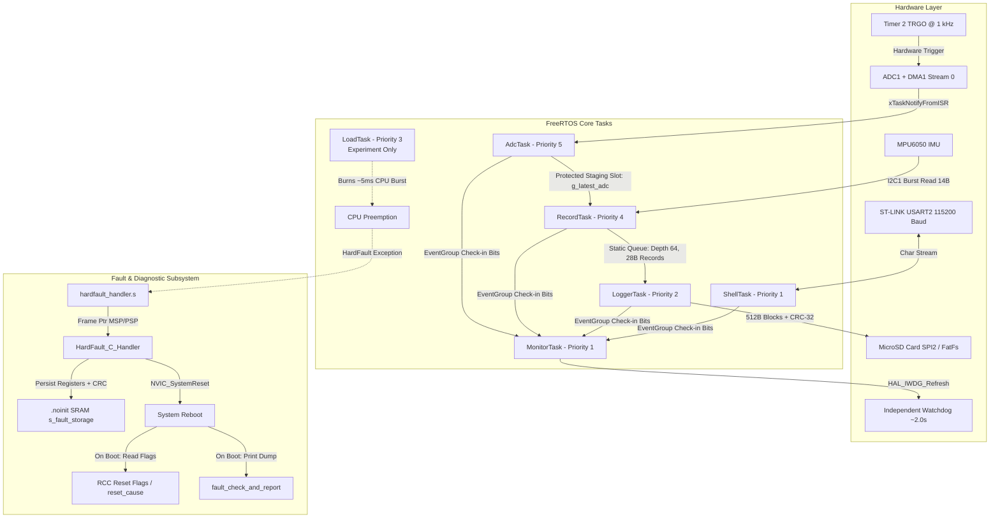

# Complete Embedded Systems Interview Preparation Guide: STM32 FreeRTOS Data Logger

This guide is your single-source reference to prepare for and confidently discuss the **STM32 FreeRTOS Data Logger** in technical firmware engineering interviews. It explains the entire architecture, source code execution flow, hardware interfaces, RTOS mechanisms, benchmark data, potential edge cases, and technical trade-offs based strictly on the verified repository implementation.

---

## 1. Project in 30 Seconds

### What to Say Aloud:
> "I developed a deterministic, high-reliability sensor data logger on an ARM Cortex-M4F STM32 microcontroller running FreeRTOS. It captures analog signals at 1 kHz using timer-triggered ADC with circular DMA double buffering and samples a 6-DOF IMU at 100 Hz over I²C. 
>
> Sensor data is packetized into CRC-32 validated, 512-byte atomic blocks and streamed to an SD card via a non-blocking queue. The system is engineered for industrial resilience: it survives abrupt power loss through pre-allocated files, monitors all task deadlines with an event-group-driven hardware watchdog, and features a custom assembly HardFault handler that saves register snapshots into uninitialized SRAM for post-mortem debugging. 
>
> I also used the system on a logic analyzer to benchmark and eliminate RTOS priority inversion across three synchronization architectures."

### Core Breakdown:
- **What it is:** Multi-task real-time embedded data logging system on STM32F446RE (ARM Cortex-M4F).
- **Problem it solves:** Sensor data acquisition systems often suffer from non-deterministic sampling jitter, silent data drops when storage media blocks, corrupted files during unexpected power disconnects, and unrecoverable system lockups.
- **Why it was built:** To implement and rigorously measure production-grade firmware practices: zero per-sample CPU overhead via DMA, non-blocking inter-task communication, hardware watchdog check-in architectures, register-level post-mortem fault tracing, and priority inversion diagnosis.
- **Main components:** `AdcTask` (DMA consumer), `RecordTask` (IMU & sensor fusion), `LoggerTask` (SD block builder & FatFs writer), `MonitorTask` (watchdog check-in supervisor), `ShellTask` (UART CLI), `LoadTask` (inversion benchmark generator), and custom assembly/C fault diagnostic handlers.

---

## 2. Project in 2 Minutes

### What to Say Aloud:
> "When building embedded data loggers, the most common trap is coupling sensor acquisition directly to storage I/O. If writing to an SD card blocks or suffers from flash garbage collection delays, sensor sampling gets delayed, jitter spikes, and data is lost.
>
> For this project, I architected a decoupled, multi-task firmware pipeline on the STM32 NUCLEO-F446RE clocked at 180 MHz using native FreeRTOS primitives. 
>
> On the acquisition side, Timer 2 triggers an ADC conversion at 1 kHz with zero CPU intervention. The ADC automatically feeds a 20-sample circular buffer via DMA. On Half-Transfer and Full-Transfer interrupts, the ISR fires a lightweight Direct Task Notification to `AdcTask`, which computes the mean, minimum, and maximum of the 10-sample window and updates a thread-safe staging slot.
>
> At 100 Hz, `RecordTask` wakes up deterministically using `vTaskDelayUntil()`. It reads the latest ADC window, performs an I²C burst read of 14 registers from an MPU6050 accelerometer and gyroscope, stamps a monotonic sequence number and 32-bit microsecond timestamp, and pushes a 28-byte record into a FreeRTOS static queue. This send is non-blocking with a timeout of zero ticks: if storage falls behind, newest samples are dropped cleanly and an explicit drop counter is incremented, guaranteeing that acquisition never stalls.
>
> The low-priority `LoggerTask` drains this queue, batches 17 records into 512-byte sector-aligned blocks, appends an IEEE 802.3 CRC-32 checksum, and writes them to an SD card. To make the filesystem impervious to sudden power cuts, log files are pre-allocated to 16 MB using FatFs `f_expand`, avoiding FAT cluster table updates during write cycles.
>
> For system integrity, a `MonitorTask` running at the lowest application priority requires an event-group check-in bit from all active tasks every 500 ms before petting the hardware Independent Watchdog (IWDG). If any task starves or deadlocks, the watchdog resets the MCU. 
>
> I also wrote a custom assembly HardFault handler that detects whether the Main or Process Stack was active, preserves the register frame and Cortex-M SCB fault registers in uninitialized `.noinit` SRAM, and prints a post-reboot diagnostic that maps directly to the faulting C code using `addr2line`.
>
> Finally, I set up a hardware logic analyzer testbench to measure priority inversion. By introducing a medium-priority `LoadTask` and comparing binary semaphores against priority-inheritance mutexes and short critical sections, I demonstrated how unbounded priority inversion causes deadline misses and how architectural separation completely eliminates the delay."

---

## 3. Architecture and Overall Working

### 3.1 Architectural Diagram



### 3.2 Diagram Explanation in Simple Terms
1. **Acquisition Pipeline (Top-Left):** Timer 2 hardware-triggers ADC1 conversions at 1 kHz without executing any software instructions. DMA transfers data continuously into a 20-sample circular array. Every 10 ms (10 samples), DMA triggers either a Half-Transfer or Full-Transfer interrupt. The ISR notifies `AdcTask` (Priority 5), which calculates summary statistics (mean, min, max) and saves them into a shared staging slot (`g_latest_adc`).
2. **Sensor Fusion & Ingestion (Center):** `RecordTask` (Priority 4) wakes every 10 ms via `vTaskDelayUntil`. It grabs the latest ADC stats under a lightweight staging lock, queries the MPU6050 over I²C for 6-axis acceleration and gyroscope values, packages all fields into a 28-byte `DataRecord_t`, and attempts to push it into a 64-element static queue (`g_record_queue`). If the queue is saturated, it increments a drop counter and continues without blocking.
3. **Storage Pipeline (Right):** `LoggerTask` (Priority 2) pulls records from the queue, stages them in an internal buffer, and assembles 512-byte blocks (`LogBlock_t`: 16B header, 17 records = 476B, 16B zero padding, 4B CRC-32). Once 17 records accumulate, it flushes the block to the SD card.
4. **Watchdog Supervision (Bottom-Center):** `MonitorTask` (Priority 1) runs every 500 ms. Each active task (`AdcTask`, `RecordTask`, `LoggerTask`, `ShellTask`) must set its designated bit in an event group (`s_monitor_events`). If all bits are set, `MonitorTask` refreshes the hardware IWDG. If any task is hung or starved, `MonitorTask` writes the missing task mask to persistent `.noinit` RAM and lets the IWDG timeout (~2.0 s) to reset the microcontroller.
5. **Fault Recovery (Bottom):** If a CPU fault occurs, assembly code determines whether the crash occurred in thread mode (`PSP`) or handler mode (`MSP`), extracts stacked register values, writes them to uninitialized RAM (`.noinit`), and resets the MCU. On reboot, the boot routine prints the faulting program counter (`PC`) and registers to UART.

---

## 4. Complete Execution Flow

### Phase A: Power-On and Hardware Reset
1. **Reset Sequence (`exercises/README.md` & Startup Assembly):**
   - Microcontroller emerges from reset. CPU loads the initial Main Stack Pointer (`MSP`) from vector table offset `0x00000000` (mapped to Flash `0x08000000`).
   - CPU loads the Reset Handler vector from `0x00000004` with bit 0 set (Thumb state) and begins execution in `Reset_Handler`.
   - `SystemInit()` is called: FPU co-processors CP10/CP11 are enabled in `SCB->CPACR`, and core clocks are initialized to 180 MHz PLL.
   - C runtime initialization: `.data` is copied from Flash LMA to SRAM VMA, `.bss` is zeroed out in SRAM, while the `.noinit` section is deliberately untouched.
   - Program branches to `main()`.

2. **Reset Cause & Fault Diagnostics:**
   - `reset_cause_detect()` (`firmware/app/fault/reset_cause.c`) reads RCC status flags:
     - `RCC_FLAG_PORRST` (Power-on reset)
     - `RCC_FLAG_PINRST` (External NRST pin reset)
     - `RCC_FLAG_SFTRST` (Software reset via `NVIC_SystemReset()`)
     - `RCC_FLAG_IWDGRST` (Independent Watchdog reset)
     - `RCC_FLAG_WWDGRST` (Window Watchdog reset)
     - `RCC_FLAG_LPWRRST` (Low-power reset)
   - It captures the enum into `s_detected_cause`, clears hardware flags with `__HAL_RCC_CLEAR_RESET_FLAGS()`, and reports the cause via `reset_cause_report()`.
   - `fault_check_and_report()` (`firmware/app/fault/hardfault.c`) inspects `s_fault_storage`. If `magic == 0xDEADC0DE` and the payload CRC-32 is valid, it prints the stacked register dump (`R0-R3, R12, LR, PC, xPSR, CFSR, HFSR, MMFAR, BFAR`), any missing watchdog tasks, and resets `magic = 0`.

3. **Peripherals & Drivers Initialization:**
   - `debug_gpio_init()` (`firmware/app/drivers/debug_gpio.c`): Configures PA8 (ADC debug), PA9 (Sensor debug), PA10 (Logger debug), PB0 (Lock debug), and PB1 (Wait debug) as push-pull outputs and clears them low.
   - `storage_init()` (`firmware/app/drivers/storage.c`): Calls FatFs `f_mount()` to mount the SD card over SPI2.
   - `storage_open_new_log()`: Scans filesystem for filenames `log_XXXX.bin`, selects next available index, opens file with `FA_CREATE_ALWAYS | FA_WRITE | FA_READ`, and pre-allocates 16 MB using `f_expand()`.
   - `mpu6050_init()` (`firmware/app/drivers/mpu6050.c`): Verifies `WHO_AM_I` register (expects `0x68`), writes `PWR_MGMT_1 = 0x00` to wake the internal oscillator, sets `SMPLRT_DIV = 7` (125 Hz internal sampling), `CONFIG = 0x03` (44 Hz DLPF), gyro range `±250°/s`, and accel range `±2g`.

### Phase B: RTOS Task & Synchronization Allocation
All FreeRTOS objects are created using static allocation (zero heap dependency):
- `staging_lock_init()` (`firmware/app/tasks/staging_lock.h`):
  - In Mode 0 (`CFG_LOCK_MODE == 0`): Creates binary semaphore via `xSemaphoreCreateBinary()` and gives it.
  - In Mode 1 & 2 (`CFG_LOCK_MODE >= 1`): Creates priority-inheritance mutex via `xSemaphoreCreateMutex()`.
- `monitor_task_start()`: Allocates `s_monitor_events` via `xEventGroupCreateStatic()` and spawns `MonitorTask` (Priority 1, Stack 256 words).
- `adc_task_start()`: Spawns `AdcTask` (Priority 5, Stack 256 words).
- `record_task_start()`: Creates static queue `g_record_queue` (depth 64, item size `sizeof(DataRecord_t)` = 28 bytes) and spawns `RecordTask` (Priority 4, Stack 512 words).
- `load_task_start()`: Spawns `LoadTask` (Priority 3, Stack 256 words).
- `logger_task_start()`: Spawns `LoggerTask` (Priority 2, Stack 1024 words).
- `shell_task_start()`: Spawns `ShellTask` (Priority 1, Stack 512 words).
- `vTaskStartScheduler()` starts preemptive multi-tasking.

### Phase C: Normal Operational Loop (Data Movement)
1. **ADC Hardware Conversion & DMA Notification:**
   - TIM2 triggers ADC1 conversions at 1000 Hz. Converted 12-bit samples stream into `s_adc_dma_buffer[20]` in circular mode.
   - At sample 10, DMA generates a Half-Transfer interrupt: `adc_dma_half_transfer_isr()` calls `xTaskNotifyFromISR(s_adc_task_handle, ADC_NOTIF_HALF_TRANSFER, eSetBits, &xHigherPriorityTaskWoken)`.
   - At sample 20, DMA generates a Full-Transfer interrupt: `adc_dma_full_transfer_isr()` sends `ADC_NOTIF_FULL_TRANSFER`.
   - `AdcTask` wakes up (`xTaskNotifyWait`), pulls pin PA8 high (`dbg_adc_set()`), iterates through 10 samples, calculates `sum`, `min`, `max`, and integer `mean`.
   - Takes `staging_lock`, writes values to `g_latest_adc`, stamps `TIM3->CNT` (microseconds), releases `staging_lock`, pulls PA8 low, and calls `monitor_task_checkin(MONITOR_BIT_ADC)`.

2. **Sensor Sampling & Queue Ingestion (`RecordTask`):**
   - Every 10 ms, `vTaskDelayUntil()` wakes `RecordTask`.
   - Asserts PB1 (`dbg_waiting_set()`), takes `staging_lock`, de-asserts PB1 (`dbg_waiting_clr()`), copies `g_latest_adc.mean, min, max` into local struct, and releases lock.
   - Asserts PA9 (`dbg_sensor_set()`), calls `mpu6050_read_all()` over I²C1 (burst read of 14 bytes starting at register `0x3B`), parses big-endian 16-bit registers into `ax, ay, az, gx, gy, gz`, and de-asserts PA9.
   - Assigns sequence number `s_sample_counter++` and microsecond timestamp `TIM3->CNT`.
   - Executes non-blocking queue push: `xQueueSend(g_record_queue, &rec, 0)`.
     - *If successful:* Record is queued.
     - *If queue is full:* Increments `s_dropped_samples` and marks record flags with `RECORD_FLAG_OVERRUN`.
   - Calls `monitor_task_checkin(MONITOR_BIT_RECORD)`.

3. **Block Serialization & SD Card Write (`LoggerTask`):**
   - `LoggerTask` blocks on `xQueueReceive(g_record_queue, &record, pdMS_TO_TICKS(100))`.
   - Feeds incoming records into `block_builder_add_record(&builder, &record)`.
   - When 17 records have accumulated, `seal_block()` sets magic `0xDA7A1068`, version `0x01`, flag `BLOCK_FLAG_COMPLETE`, session ID, and first sequence number, zeroes the 16 trailing padding bytes, and calculates CRC-32 across bytes 0 to 507 (`crc32_compute`).
   - `block_builder_add_record()` returns `true` (`block_full`).
   - `LoggerTask` raises PA10 (`dbg_logger_set()`).
     - Under Mode 1/0: Holds `staging_lock` and waits 4 ms artificial delay (experiment benchmark).
     - Under Mode 2: Performs fast in-memory copy of `builder.current_block` under lock, releases lock, and writes to SD card outside lock.
   - Calls `storage_write_block()` (`f_write`), increments `s_blocks_written`, calls `block_builder_reset_ready()`, and clears PA10.
   - Calls `monitor_task_checkin(MONITOR_BIT_LOGGER)`.

4. **Watchdog Supervision (`MonitorTask`):**
   - Wakes every 500 ms via `vTaskDelay()`.
   - Queries `s_monitor_events` with `MONITOR_ALL_TASKS_MASK` (`ADC | RECORD | LOGGER | SHELL`).
   - If all bits match, calls `HAL_IWDG_Refresh(&hiwdg)`.
   - If any bit is missing, sets `fault_set_missing_tasks(missing)` and skips refresh. After 2.0 s, IWDG fires hardware reset.

---

## 5. Module-by-Module Technical Deep Dive

### 5.1 Common Subsystem

#### `firmware/app/common/config.h`
- **Responsibility:** Central system manifest defining all compile-time sample rates, stack depths, task priorities, watchdog timings, and synchronization modes.
- **Key Symbols & Values:**
  - `CFG_ADC_SAMPLE_RATE_HZ` (`1000U`): ADC hardware timer trigger rate.
  - `CFG_SENSOR_RATE_HZ` (`100U`): Target execution rate for `RecordTask` (10 ms period).
  - `CFG_DMA_HALF_BUF_SAMPLES` (`10U`): Buffer size per half transfer (20 samples total circular buffer = 10 ms of data).
  - `CFG_RECORD_QUEUE_DEPTH` (`64U`): Max queued records (holds ~640 ms of sensor data during SD card write latency spikes).
  - `CFG_RECORDS_PER_BLOCK` (`17U`): Records per 512-byte block.
  - `PRI_ADC_TASK` (`5`), `PRI_RECORD_TASK` (`4`), `PRI_LOAD_TASK` (`3`), `PRI_LOGGER_TASK` (`2`), `PRI_SHELL_TASK` (`1`), `PRI_MONITOR_TASK` (`1`).
  - `CFG_LOCK_MODE`: Selects synchronization mode (`0` = Binary Semaphore / Mode A, `1` = Mutex / Mode B, `2` = Short Critical Section / Mode C). Default is `1`.

#### `firmware/app/common/record_format.h`
- **Responsibility:** Defines wire-format binary layout for individual sensor samples and 512-byte storage blocks. Pack-aligned `#pragma pack(push, 1)`.
- **Structures:**
  - `DataRecord_t` (28 bytes exactly):
    - `uint32_t seq`: Monotonically increasing sequence ID.
    - `uint32_t timestamp_us`: Microsecond timestamp from hardware timer `TIM3`.
    - `int16_t adc_mean, adc_min, adc_max`: Processed ADC statistics.
    - `int16_t ax, ay, az, gx, gy, gz`: 16-bit raw 2's complement readings from MPU6050.
    - `uint16_t flags`: Bitfield (`RECORD_FLAG_OVERRUN = 0x0001`, `RECORD_FLAG_FAULT_EVENT = 0x0002`, `RECORD_FLAG_RATE_CHANGED = 0x0004`).
  - `LogBlock_t` (512 bytes exactly):
    - `uint32_t magic` (`0xDA7A1068`): Block identifier.
    - `uint8_t version` (`0x01`): Format revision.
    - `uint8_t flags` (`BLOCK_FLAG_COMPLETE = 0x01`, `BLOCK_FLAG_INCOMPLETE = 0x02`).
    - `uint16_t record_count`: Number of active records (1 to 17).
    - `uint32_t first_seq`: Sequence number of `records[0]`.
    - `uint32_t session_id`: Unique identifier per logging session / boot.
    - `DataRecord_t records[17]`: 17 × 28 bytes = 476 bytes.
    - `uint8_t padding[16]`: 16 zeroed bytes (492 to 507) aligning block to 508 bytes.
    - `uint32_t crc32`: Checksum over bytes 0..507.
- **Static Assertions:** Lines 66-67 verify at compile-time that `sizeof(DataRecord_t) == 28` and `sizeof(LogBlock_t) == 512`.

#### `firmware/app/common/block_builder.c` & `.h`
- **Responsibility:** Manages the accumulation of raw records into sector-aligned blocks, padding unpopulated slots, and calculating block-level CRC-32.
- **Key Functions:**
  - `block_builder_init(BlockBuilder_t *builder, uint32_t session_id)`: Clears builder struct, assigns session ID, sets `records_buffered = 0`.
  - `block_builder_add_record(BlockBuilder_t *builder, const DataRecord_t *record)`: Copies record into `records[records_buffered]`. If `records_buffered == 17`, calls `seal_block(builder, BLOCK_FLAG_COMPLETE)` and returns `true`.
  - `block_builder_flush(BlockBuilder_t *builder)`: Flushes partial block (e.g. on log stop). Calls `seal_block(builder, BLOCK_FLAG_INCOMPLETE)`.
  - `seal_block(BlockBuilder_t *builder, uint8_t flag)`: Sets header metadata, zeroes any unfilled record slots up to 17, zeroes 16 padding bytes, computes CRC-32 over `offsetof(LogBlock_t, crc32)` (508 bytes), and marks `block_ready = true`.
  - `block_builder_reset_ready(BlockBuilder_t *builder)`: Clears block buffer and resets counter to zero.

#### `firmware/app/common/crc32.c` & `.h`
- **Responsibility:** Hardware-independent IEEE 802.3 CRC-32 calculation using a precomputed 256-entry lookup table (`crc32_table`).
- **Polynomial:** Standard Ethernet/PKZIP polynomial `0xEDB88320` (reversed representation of `0x04C11DB7`).
- **Key Functions:**
  - `crc32_update(uint32_t current_crc, const uint8_t *data, size_t length)`: Iteratively digests buffer.
  - `crc32_compute(const uint8_t *data, size_t length)`: Seeds with `0xFFFFFFFF`, calls `crc32_update()`, and XORs with `0xFFFFFFFF`.
- **Validation:** Unit-tested on host against standard ASCII vector `"123456789"` (`0xCBF43926`).

---

### 5.2 Drivers Subsystem

#### `firmware/app/drivers/debug_gpio.c` & `.h`
- **Responsibility:** Register/HAL driver controlling 5 dedicated logic analyzer instrumentation pins configured for maximum slew rate (`GPIO_SPEED_FREQ_VERY_HIGH`).
- **Pin Allocations:**
  - PA8: `DBG_ADC_PIN` (Toggled in `process_adc_buffer`)
  - PA9: `DBG_SENSOR_PIN` (Toggled in `RecordTask` during I²C read)
  - PA10: `DBG_LOGGER_PIN` (Toggled in `LoggerTask` during SD card block write)
  - PB0: `DBG_LOCK_PIN` (Asserted while `LoggerTask` holds `staging_lock`)
  - PB1: `DBG_WAITING_PIN` (Asserted while `RecordTask` blocks waiting for `staging_lock`)
- **Key Functions:** Inline macros `dbg_adc_set()`, `dbg_adc_clr()`, `dbg_lock_set()`, etc., wrapping `HAL_GPIO_WritePin()`.

#### `firmware/app/drivers/mpu6050.c` & `.h`
- **Responsibility:** I²C driver for InvenSense MPU6050 6-axis motion tracking sensor.
- **Device Address:** `0xD0` (`0x68 << 1`, AD0 grounded).
- **Key Functions:**
  - `mpu6050_init(I2C_HandleTypeDef *hi2c)`:
    - Verifies device responds with `0x68` at register `0x75` (`MPU6050_REG_WHO_AM_I`).
    - Clears sleep bit: `PWR_MGMT_1` (`0x6B`) = `0x00`.
    - `SMPLRT_DIV` (`0x19`) = `0x07` (sample rate = 1 kHz / (1 + 7) = 125 Hz).
    - `CONFIG` (`0x1A`) = `0x03` (enables Digital Low Pass Filter at 44 Hz bandwidth, 4.9 ms delay).
    - `GYRO_CONFIG` (`0x1B`) = `0x00` (±250 °/s, sensitivity 131 LSB/(°/s)).
    - `ACCEL_CONFIG` (`0x1C`) = `0x00` (±2g, sensitivity 16384 LSB/g).
  - `mpu6050_read_all(hi2c, ax, ay, az, gx, gy, gz)`: Performs single 14-byte I²C burst read starting at register `0x3B` (`ACCEL_XOUT_H`) through `0x48`. Reads high/low bytes for Accel X/Y/Z, Temp (ignored), and Gyro X/Y/Z in one transaction within a 50 ms timeout.

#### `firmware/app/drivers/storage.c` & `.h`
- **Responsibility:** Abstraction layer interfacing with FatFs (`ff.h`) on MicroSD card via SPI2.
- **Key Functions:**
  - `storage_init()`: Invokes `f_mount(&s_fatfs, "", 1)` to mount storage immediately.
  - `storage_open_new_log(uint16_t *file_num_out)`: Sequentially scans `log_0001.bin` to `log_9999.bin` using `f_stat()`. Opens first unused file with `FA_CREATE_ALWAYS | FA_WRITE | FA_READ`. Pre-allocates 16 MB using `f_expand()` if `FF_USE_EXPAND` is enabled.
  - `storage_write_block(const LogBlock_t *block)`: Executes sector write via `f_write(&s_current_file, block, sizeof(LogBlock_t), &bytes_written)`.
  - `storage_flush()`: Commits cached writes via `f_sync()`.
  - `storage_scan_last_valid(uint32_t *recovered_records_out)`: Boot-time scan function. Reads blocks sequentially, checks `magic == 0xDA7A1068` and computes CRC-32. Stops at first corrupted block and returns total valid records recovered.

---

### 5.3 Tasks & Synchronization Subsystem

#### `firmware/app/tasks/staging_lock.h`
- **Responsibility:** Encapsulates the shared synchronization primitive used to demonstrate priority inversion.
- **Implementation:**
  - Under `CFG_LOCK_MODE == 0` (Mode A): `g_staging_lock_handle = xSemaphoreCreateBinary()`. Binary semaphores in FreeRTOS do not implement priority inheritance.
  - Under `CFG_LOCK_MODE >= 1` (Mode B & C): `g_staging_lock_handle = xSemaphoreCreateMutex()`. Standard mutexes include priority inheritance.
  - Wrapper functions: `staging_lock_acquire()` (`xSemaphoreTake(..., portMAX_DELAY)`) and `staging_lock_release()` (`xSemaphoreGive(...)`).

#### `firmware/app/tasks/adc_task.c` & `.h`
- **Responsibility:** Highest priority processing task (Priority 5). Ingests raw DMA buffers and publishes processed analog summaries.
- **Key Functions:**
  - `adc_task_start()`: Statically allocates task stack (`STACK_ADC_TASK = 256` words) and TCB.
  - `adc_task_code(void *params)`: Blocks indefinitely on `xTaskNotifyWait(0, ULONG_MAX, &notif_value, portMAX_DELAY)`.
    - If `notif_value & ADC_NOTIF_HALF_TRANSFER`, processes first half of circular buffer (`s_adc_dma_buffer[0..9]`).
    - If `notif_value & ADC_NOTIF_FULL_TRANSFER`, processes second half (`s_adc_dma_buffer[10..19]`).
    - Calls `monitor_task_checkin(MONITOR_BIT_ADC)`.
  - `process_adc_buffer(samples, count)`: Sets PA8 high (`dbg_adc_set()`), iterates through 10 samples, calculates `mean`, `min`, `max`, acquires `staging_lock`, writes to global `g_latest_adc`, stamps `TIM3->CNT`, releases lock, and sets PA8 low.
  - `adc_dma_half_transfer_isr()` & `adc_dma_full_transfer_isr()`: Call `xTaskNotifyFromISR()` with `eSetBits`, setting `xHigherPriorityTaskWoken` to request immediate context switch on interrupt exit via `portYIELD_FROM_ISR()`.

#### `firmware/app/tasks/record_task.c` & `.h`
- **Responsibility:** Deterministic sensor fusion task (Priority 4). Runs at 100 Hz (configurable 10-500 Hz).
- **Key Functions:**
  - `record_task_start()`: Statically creates `g_record_queue` (depth 64, item size 28B) and task TCB/stack (512 words).
  - `record_task_code(void *params)`: Maintains strict periodicity using `vTaskDelayUntil(&last_wake_time, pdMS_TO_TICKS(1000 / s_current_rate_hz))`.
  - Sets PB1 (`dbg_waiting_set()`), acquires `staging_lock`, clears PB1, copies `g_latest_adc` metrics, and releases lock.
  - Sets PA9 (`dbg_sensor_set()`), executes I²C read via `mpu6050_read_all()`, and clears PA9.
  - Enqueues record via `xQueueSend(g_record_queue, &rec, 0)`. If queue full (`!= pdPASS`), increments `s_dropped_samples` and appends `RECORD_FLAG_OVERRUN`.
  - Calls `monitor_task_checkin(MONITOR_BIT_RECORD)`.

#### `firmware/app/tasks/load_task.c` & `.h`
- **Responsibility:** Synthetic medium-priority CPU interference task (Priority 3). Used solely to trigger priority inversion in Mode A benchmarks.
- **Key Functions:**
  - `load_task_code(void *params)`: Executes every 50 ms (`vTaskDelayUntil`).
  - When enabled (`s_load_enabled == true`), executes a busy-wait spin loop (`count < 100000`), consuming ~5 ms of CPU cycles at 180 MHz without blocking or yielding.

#### `firmware/app/tasks/logger_task.c` & `.h`
- **Responsibility:** Low-priority storage writer (Priority 2). Batches records into blocks and commits them to SD storage.
- **Key Functions:**
  - `logger_task_code(void *params)`: Waits up to 100 ms on `xQueueReceive(g_record_queue, &record, ...)`.
  - Packs records via `block_builder_add_record(&builder, &record)`.
  - When block is full:
    - Raises PA10 (`dbg_logger_set()`).
    - **In Mode 0 & 1:** Raises PB0 (`dbg_lock_set()`), acquires `staging_lock`, delays 4 ms (`vTaskDelay(4)`), calls `storage_write_block()`, releases lock, and clears PB0.
    - **In Mode 2:** Acquires `staging_lock`, performs structure copy (`local_block_copy = builder.current_block`), releases lock immediately, and calls `storage_write_block()` *outside* the lock.
    - Clears PA10 (`dbg_logger_clr()`), increments `s_blocks_written`, and calls `block_builder_reset_ready()`.
  - Calls `monitor_task_checkin(MONITOR_BIT_LOGGER)`.

#### `firmware/app/tasks/monitor_task.c` & `.h`
- **Responsibility:** System safety watchdog supervisor running at lowest application priority (Priority 1, Stack 256 words).
- **Key Functions:**
  - `monitor_task_code(void *params)`: Runs every 500 ms.
  - Queries `xEventGroupWaitBits(s_monitor_events, MONITOR_ALL_TASKS_MASK, pdTRUE, pdFALSE, 0)`.
  - If bits match `MONITOR_BIT_ADC | MONITOR_BIT_RECORD | MONITOR_BIT_LOGGER | MONITOR_BIT_SHELL`:
    - Calls `HAL_IWDG_Refresh(&hiwdg)`.
  - If any bit is missing:
    - Calculates missing mask: `MONITOR_ALL_TASKS_MASK & (~bits)`.
    - Saves mask to persistent memory: `fault_set_missing_tasks(missing)`.
    - Skips watchdog refresh, allowing hardware IWDG to trigger reset after 2.0 s.
  - `monitor_task_force_hang()`: Induces watchdog failure for testing by setting `s_force_hang = true` and entering `vTaskDelay(portMAX_DELAY)`.

#### `firmware/app/tasks/shell_task.c` & `shell_parser.c`
- **Responsibility:** Interactive serial CLI over USART2 (115200 8N1).
- **Execution:** Runs at Priority 1, Stack 512 words. Receives characters non-blocking (`HAL_UART_Receive(..., timeout=100)`), buffers input up to 128 bytes, handles backspace (`\b` or `127`), and echoes characters.
- **Command Dispatcher (`execute_command`):**
  - `help`: Lists all supported commands.
  - `status`: Displays uptime, sample count, drop count, blocks written, active rate, logging status, and lock mode.
  - `stats`: Prints FreeRTOS task run-time stats if `configGENERATE_RUN_TIME_STATS == 1`.
  - `rate <hz>`: Dynamically updates sampling frequency (10 to 500 Hz) via `record_task_set_rate_hz()`.
  - `start` / `stop`: Calls `logger_task_request_start()` / `logger_task_request_stop()`.
  - `ls`: Stubs SD card directory listing (`"File listing requires active FatFs SD card.\n"`).
  - `dump <file>`: Stubs CSV dump to terminal (`"Streaming %s as CSV to console...\n"`).
  - `fault <type>`: Triggers deliberate crash (`fault_trigger(arg1)`).
  - `wdtest`: Triggers watchdog timeout (`monitor_task_force_hang()`).
  - `reset`: Performs immediate reboot via `NVIC_SystemReset()`.
  - `version`: Outputs firmware version and build date/time.

---

### 5.4 Fault & Diagnostics Subsystem

#### `firmware/app/fault/hardfault_handler.s`
- **Responsibility:** Assembly exception vector for HardFault.
- **Stack Pointer Resolution:**
  ```assembly
  HardFault_Handler:
      tst   lr, #4            /* Test bit 2 of EXC_RETURN */
      ite   eq
      mrseq r0, msp           /* If bit 2 is 0: Main Stack Pointer was active (ISR or pre-OS) */
      mrsne r0, psp           /* If bit 2 is 1: Process Stack Pointer was active (FreeRTOS task) */
      b     HardFault_C_Handler
  ```
- **Why this is critical:** FreeRTOS tasks execute using the Process Stack Pointer (`PSP`), whereas ISRs and boot code execute using the Main Stack Pointer (`MSP`). If a generic handler only reads `MSP`, attempting to inspect stacked registers after a task crash reads uninitialized stack data instead of the task's actual CPU registers!

#### `firmware/app/fault/hardfault.c` & `.h`
- **Responsibility:** Captures stacked exception frame and hardware registers into uninitialized memory, calculates CRC-32, and forces a clean reset.
- **Storage Location:** Placed in `.noinit` SRAM section (`__attribute__((section(".noinit"))) volatile FaultInfo_t s_fault_storage;`). The C startup code does not overwrite or zero this section.
- **Captured Information (`FaultInfo_t`):**
  - Stacked registers: `R0, R1, R2, R3, R12, LR, PC, xPSR` (from `frame[0..7]`).
  - SCB status registers:
    - `CFSR` (`0xE000ED28`): Configurable Fault Status Register (encapsulates MMFSR, BFSR, and UFSR).
    - `HFSR` (`0xE000ED2C`): HardFault Status Register (indicates vector fetch error or forced escalations).
    - `MMFAR` (`0xE000ED34`): Memory Management Fault Address Register.
    - `BFAR` (`0xE000ED38`): BusFault Address Register.
  - `missing_tasks_mask`: Populated if crash was preceded by a watchdog timeout.
  - `crc32`: Integrity checksum protecting the entire struct.
- **Fault Trigger Demonstration (`fault_trigger`):**
  - `"null"`: Dereferences address `0x00000000` (causes BusFault/HardFault).
  - `"divzero"`: Enables `SCB->CCR |= SCB_CCR_DIV_0_TRP_Msk` and divides 100 by 0 (causes UsageFault).
  - `"unaligned"`: Enables `SCB->CCR |= SCB_CCR_UNALIGN_TRP_Msk` and performs 32-bit load from unaligned pointer `&buf[1]`.
  - `"invstate"`: Executes jump to an address with Thumb bit cleared (bit 0 = 0), triggering invalid state UsageFault.

#### `firmware/app/fault/reset_cause.c` & `.h`
- **Responsibility:** Decodes hardware RCC reset flags on boot to determine how the MCU started.
- **RCC Status Register Evaluation:** Evaluates flags in order: `LPWRRST` -> `WWDGRST` -> `IWDGRST` -> `SFTRST` -> `PORRST` -> `PINRST`. Clears flags immediately with `__HAL_RCC_CLEAR_RESET_FLAGS()`.

---

## 6. Important Technical Concepts Used

### 1. Circular DMA Double-Buffering
- **What it does:** Transfers ADC conversion results into a continuous ring buffer in SRAM without CPU intervention, alerting the CPU only when half or full buffers are ready.
- **Why it is needed:** Sampling at 1 kHz using interrupts would require 1,000 ISR entries per second. Double-buffering reduces CPU interrupts to 100 Hz (every 10 samples) and eliminates sampling jitter.
- **How it works internally:** DMA peripheral writes incoming 16-bit words into memory. At the halfway mark (`CFG_DMA_HALF_BUF_SAMPLES = 10`), DMA fires a Half-Transfer (`HT`) interrupt. The CPU processes the first half while the DMA controller writes the second half. At the end, DMA fires a Full-Transfer (`TC`) interrupt, wraps back to index 0, and continues.
- **Implementation:** `firmware/app/tasks/adc_task.c` (`s_adc_dma_buffer[20]`, `adc_dma_half_transfer_isr()`, `adc_dma_full_transfer_isr()`).
- **If removed:** CPU would need to service an ADC interrupt every 1 ms, increasing context-switch overhead and risking missed samples if another high-priority ISR runs.
- **Practical Example:** An audio codec streaming 48 kHz samples: DMA fills Ping while CPU processes Pong, preventing audio dropouts.

---

### 2. Direct-to-Task Notifications (`xTaskNotifyFromISR`)
- **What it does:** Sends an event flag directly from an interrupt handler to unblock a specific task without allocating an intermediate RTOS queue or semaphore.
- **Why it is needed:** Ultra-low latency and zero memory overhead. Directly updates the target task's Task Control Block (`TCB`).
- **How it works internally:** The ISR calls `xTaskNotifyFromISR()` with `eSetBits`. The RTOS sets the corresponding bit in the task's 32-bit notification value, moves the task from the Blocked list to the Ready list, and sets `xHigherPriorityTaskWoken = pdTRUE`.
- **Implementation:** `firmware/app/tasks/adc_task.c` (lines 98, 108).
- **If removed:** Replacing it with an `xQueueSendFromISR` would require allocating queue memory and performing pointer manipulation and copy operations inside the ISR, increasing interrupt latency.
- **Practical Example:** An external emergency stop button or DMA completion flag waking an actuator driver in sub-microsecond time.

---

### 3. Absolute Periodic Delay (`vTaskDelayUntil`)
- **What it does:** Suspends task execution until an absolute target tick count arrives, ensuring exact periodic execution intervals.
- **Why it is needed:** Standard `vTaskDelay(n)` delays relative to when the function is called, causing execution time drift over time. `vTaskDelayUntil()` prevents cumulative timing drift.
- **How it works internally:** FreeRTOS tracks `last_wake_time`. In each cycle, it adds `period_ticks` to `last_wake_time` and places the task on the delayed list until that exact tick arrives.
- **Implementation:** `firmware/app/tasks/record_task.c` (line 45).
- **If removed:** IMU sampling at 100 Hz would drift depending on how long I²C transactions take, causing timing jitter.
- **Practical Example:** PID control loops in quadcopter flight controllers that require deterministic delta-t for integration and derivative terms.

---

### 4. Priority Inversion and Priority Inheritance
- **What it does:** Priority inversion occurs when a low-priority task holds a shared resource needed by a high-priority task, and a medium-priority task preempts the low-priority task, indefinitely delaying the high-priority task. Priority inheritance temporarily elevates the low-priority task's priority to that of the blocked high-priority task.
- **Why it is needed:** Without inheritance, medium-priority background work can cause high-priority sensor tasks to miss deadlines.
- **How it works internally:** When Task H attempts to take a mutex owned by Task L, the FreeRTOS scheduler boosts Task L's priority to match Task H until Task L releases the mutex.
- **Implementation:** Demonstrated across Mode A (`xSemaphoreCreateBinary` in `staging_lock.h`), Mode B (`xSemaphoreCreateMutex`), and Mode C (`logger_task.c`).
- **If removed:** In Mode A, `LoadTask` (P=3) preempts `LoggerTask` (P=2) holding `staging_lock`, causing `RecordTask` (P=4) to wait 9.2 ms and miss deadlines.
- **Practical Example:** Mars Pathfinder spacecraft reset anomaly in 1997, where an information bus mutex lacked inheritance and caused watchdog resets.

---

### 5. Sector-Aligned Atomic Block Framing & Power-Loss Pre-Allocation
- **What it does:** Organizes flash/SD storage into self-contained 512-byte blocks matching physical sector geometry and pre-allocates file size on disk.
- **Why it is needed:** SD flash memory writes occur in 512-byte physical sectors. Pre-allocating files prevents corrupting the filesystem FAT table during an unexpected power cut.
- **How it works internally:** 17 records × 28 bytes = 476 bytes, plus a 16-byte header, 16 bytes of zero-padding, and a 4-byte CRC-32 = 512 bytes. FatFs `f_expand()` marks all clusters on card format, so during logging only sector data changes—FAT directory metadata remains untouched.
- **Implementation:** `firmware/app/common/record_format.h` (`LogBlock_t`), `firmware/app/drivers/storage.c` (`f_expand`).
- **If removed:** Power loss during dynamic file expansion corrupts cluster allocation tables, leaving the file 0 bytes in length.
- **Practical Example:** Automotive event data recorders (black boxes) that must preserve crash data even when the battery disconnects on impact.

---

### 6. Hardware Watchdog Multi-Task Event-Group Check-in
- **What it does:** Refreshes the hardware watchdog only if every active task reports liveness within the supervisor window.
- **Why it is needed:** If a single task handles watchdog kicking, the watchdog will continue being refreshed even if other critical tasks are deadlocked or starved.
- **How it works internally:** Each task sets a bit in a FreeRTOS event group. A low-priority supervisor task waits periodically. If all bits are present, it clears them and pets the watchdog.
- **Implementation:** `firmware/app/tasks/monitor_task.c` (`s_monitor_events`, `MONITOR_ALL_TASKS_MASK`).
- **If removed:** If `RecordTask` deadlocks on I²C while `ShellTask` continues running, a single-task watchdog kicker would never reset the system.
- **Practical Example:** Medical infusion pumps where motor control, dose calculation, and display tasks must all check in before hardware watchdog refresh.

---

### 7. Non-Zeroed SRAM (`.noinit`) Crash Dumps
- **What it does:** Preserves CPU register states across hardware and software resets without using external EEPROM.
- **Why it is needed:** Captures transient, non-reproducible HardFaults and bus errors in production environments for post-reboot analysis.
- **How it works internally:** Memory declared with `__attribute__((section(".noinit")))` is placed outside `.bss` and `.data`. During startup, C runtime initialization skips this region. The contents survive until RAM loses power.
- **Implementation:** `firmware/app/fault/hardfault.c` (`s_fault_storage`), `hardfault_handler.s`.
- **If removed:** After a HardFault and reset, all register clues are erased, leaving developers guessing why the system crashed.
- **Practical Example:** Aerospace flight computers logging exception addresses into battery-backed SRAM.

---

## 7. Technical Decisions and Trade-offs

### 1. Static vs Dynamic FreeRTOS Allocation
- **Decision:** Used 100% static allocation (`xTaskCreateStatic`, `xQueueCreateStatic`, `xEventGroupCreateStatic`).
- **Inferred Engineering Rationale:** Embedded systems requiring 24/7 reliability cannot risk non-deterministic heap allocation failures or memory fragmentation.
- **Alternatives:** Dynamic allocation via `pvPortMalloc()` using FreeRTOS `heap_4.c`.
- **Trade-offs & Limitations:** Static allocation fixes queue and stack sizes at compile-time, preventing dynamic resizing. However, it guarantees zero out-of-memory crashes after boot.
- **Rebuild Alternative:** Keep static allocation; it is best practice for high-reliability systems.

### 2. DMA Notification vs FreeRTOS Queue for ADC Samples
- **Decision:** Direct Task Notification (`xTaskNotifyFromISR`) from DMA ISR to `AdcTask`.
- **Inferred Engineering Rationale:** The ADC double buffer is a pre-allocated static array. Copying samples into an RTOS queue inside an ISR wastes CPU cycles and memory.
- **Alternatives:** `xQueueSendFromISR()` pushing 10-sample arrays.
- **Trade-offs & Limitations:** Notifications only transfer a 32-bit integer, requiring the receiving task to access the shared array directly.
- **Rebuild Alternative:** Retain direct notifications; it minimizes ISR execution time to <1 microsecond.

### 3. Non-Blocking Saturated Queue Drop vs Blocking Sensor Acquisition
- **Decision:** `xQueueSend(g_record_queue, &rec, 0)` with zero block time. Dropped records increment `s_dropped_samples`.
- **Inferred Engineering Rationale:** Real-time sensor sampling must never block on slow downstream peripherals (like SD card flash writes).
- **Alternatives:** Blocking queue write (`portMAX_DELAY` or `pdMS_TO_TICKS(50)`).
- **Trade-offs & Limitations:** Under sustained write bottlenecks, intermediate samples are permanently dropped. However, the sampling cadence remains perfectly deterministic.
- **Rebuild Alternative:** Keep non-blocking drops, but add a larger intermediate ring buffer in external PSRAM for high-bandwidth burst logging.

### 4. Mode C Short Critical Section vs Mode B Priority Inheritance
- **Decision:** Implemented Mode C (rapid structure copy under lock, physical write outside lock) as the production architectural fix.
- **Inferred Engineering Rationale:** While priority inheritance (Mode B) prevents medium-priority tasks from preempting the lock holder, high-priority tasks are still forced to wait for physical I/O writes. Minimizing the lock duration to an in-memory copy eliminates the bottleneck entirely.
- **Alternatives:** Mode B (Priority-inheritance mutex around the entire physical SD write).
- **Trade-offs & Limitations:** Requires allocating a temporary `LogBlock_t` copy (512 bytes) on the task stack, increasing stack memory usage.
- **Rebuild Alternative:** Retain Mode C architecture across all shared firmware resources.

---

## 8. Tricky Parts, Quirks, and Potential Bugs

### 1. HardFault Stack Pointer Ambiguity (MSP vs PSP)
- **What is happening:** Cortex-M processors maintain two stack pointers: Main Stack Pointer (`MSP`) and Process Stack Pointer (`PSP`). FreeRTOS user tasks run on `PSP`, whereas interrupts and early boot code use `MSP`.
- **Why it is tricky:** Upon entering an exception handler, the hardware pushes registers `R0-R3, R12, LR, PC, xPSR` to whichever stack was active when the fault occurred. If a C handler naively casts `__get_MSP()`, it reads garbage if the fault occurred in a FreeRTOS task.
- **How it is handled:** `firmware/app/fault/hardfault_handler.s` inspects bit 2 of `EXC_RETURN` in `LR`. If bit 2 is 0, it loads `MSP` into `R0`; if bit 2 is 1, it loads `PSP` into `R0`, then branches to `HardFault_C_Handler`.
- **Verification:** Verified by inspecting assembly stub in `firmware/app/fault/hardfault_handler.s`.

### 2. NVIC vs FreeRTOS Priority Direction Inversion
- **What is happening:** In ARM Cortex-M hardware NVIC registers, **lower numerical values represent higher urgency** (Priority 0 is highest). In FreeRTOS, **higher numerical values represent higher urgency** (Priority 5 is higher than Priority 1).
- **Why it is tricky:** Any interrupt that calls FreeRTOS `...FromISR` APIs must have an NVIC priority numerically greater than or equal to `configLIBRARY_MAX_SYSCALL_INTERRUPT_PRIORITY` (typically 5). If an ISR with NVIC priority 0-4 calls FreeRTOS APIs, it can preempt an RTOS critical section, corrupting kernel linked lists and causing unexplainable HardFaults.
- **How it is handled:** Verified in `exercises/README.md` and `exercises/tim_irq.c` (NVIC priority set to `0x50`, bits [7:4] = 5).

### 3. Missing Stub Implementations in Shell Task (`ls` & `dump`)
- **What is happening:** `SHELL_CMD_LS` and `SHELL_CMD_DUMP` in `firmware/app/tasks/shell_task.c` (lines 109-120) are stubs:
  ```c
  case SHELL_CMD_LS:
      shell_printf("File listing requires active FatFs SD card.\n");
      break;
  case SHELL_CMD_DUMP:
      if (cmd->argc >= 1) {
          shell_printf("Streaming %s as CSV to console...\n", cmd->arg1);
      }
      break;
  ```
- **Why it is tricky:** The README states that `dump <file>` streams binary files as CSV formatted text to terminal. However, the actual C source code does not open or read the file; it only prints the confirmation message.
- **Potential Bug / Gap:** Attempting to dump a log in the shell on hardware will not stream data.
- **Better Solution:** Implement `f_open()`, iterate through `LogBlock_t` records, format each as a CSV string, and stream via `shell_printf()`.

### 4. Non-Atomic Read of Multi-Word `g_latest_adc` Without Staging Lock
- **What is happening:** `g_latest_adc` contains four fields (`mean`, `min`, `max`, `timestamp_us`).
- **Why it is tricky:** If `RecordTask` reads `g_latest_adc` while `AdcTask` is preempting and updating it, `RecordTask` could read an updated `mean` paired with an old `min` and `max` (torn read).
- **How it is handled:** Protected by `staging_lock_acquire()` and `staging_lock_release()` in both `adc_task.c` and `record_task.c`.

### 5. Watchdog Event-Group Reset Race Condition
- **What is happening:** `MonitorTask` calls `xEventGroupWaitBits(..., pdTRUE, pdFALSE, 0)` with `pdTRUE` to clear bits upon reading.
- **Why it is tricky:** If a fast task (like `AdcTask` at 100 Hz) sets its check-in bit immediately before `MonitorTask` runs, the bit is cleared. If `AdcTask` subsequently hangs during the next 500 ms window, `MonitorTask` will notice its absence on the next evaluation.
- **How it is handled:** Because `MonitorTask` period is 500 ms and `AdcTask` checks in every 10 ms, `AdcTask` has 50 opportunities to set its bit during normal operation.

---

## 9. Important Numbers and Configurations

| Parameter | Exact Value | Defining File | Architectural Significance |
|---|---|---|---|
| **MCU Core Clock** | 180 MHz | `README.md`, `exercises/uart_bare.c` | Max clock speed for STM32F446RE; determines instruction cycle timings |
| **ADC Trigger Rate** | 1000 Hz (1 ms) | `config.h` (`CFG_ADC_SAMPLE_RATE_HZ`) | Timer 2 TRGO update frequency driving ADC conversions |
| **Sensor Task Rate** | 100 Hz (10 ms) | `config.h` (`CFG_SENSOR_RATE_HZ`) | `RecordTask` periodic wakeup rate via `vTaskDelayUntil` |
| **DMA Buffer Depth** | 20 samples (10 + 10) | `config.h` (`CFG_DMA_HALF_BUF_SAMPLES`) | 10 samples per half-transfer (10 ms window matching sensor task) |
| **Record Queue Depth**| 64 elements | `config.h` (`CFG_RECORD_QUEUE_DEPTH`) | Holds 64 × 28B = 1,792B of unwritten samples (~640 ms buffer) |
| **Records Per Block** | 17 records | `config.h` (`CFG_RECORDS_PER_BLOCK`) | 17 × 28 bytes = 476 bytes payload per 512B sector |
| **Block Size** | 512 bytes | `config.h` (`CFG_SD_BLOCK_BYTES`) | Matches physical SD/Flash sector geometry |
| **Padding Bytes** | 16 bytes | `record_format.h` (`LogBlock_t.padding`) | Aligns block to 508 bytes prior to 4-byte CRC-32 |
| **Magic Number** | `0xDA7A1068` | `record_format.h` (`BLOCK_MAGIC`) | ASCII "DATA LOG" block identifier |
| **Format Version** | `0x01` | `record_format.h` (`BLOCK_VERSION`) | Framing structure schema version |
| **Fault Magic** | `0xDEADC0DE` | `hardfault.h` (`FAULT_MAGIC_VALUE`) | Marks valid crash dump in uninitialized `.noinit` SRAM |
| **Watchdog Timeout** | ~2000 ms | `config.h` (`CFG_WDG_TIMEOUT_MS`) | Hardware window before un-serviced IWDG resets the MCU |
| **Monitor Task Period**| 500 ms | `config.h` (`CFG_MONITOR_PERIOD_MS`) | Task check-in evaluation and watchdog refresh cadence |
| **Pre-Allocated File**| 16 MB | `config.h` (`CFG_LOG_MAX_SIZE_MB`) | `f_expand` allocation size to prevent runtime FAT updates |
| **UART Shell Baud** | 115200 8N1 | `docs/pinmap.md`, `uart_bare.c` | ST-LINK Virtual COM port baud rate (`USART2_BRR = 0x008B`) |
| **MPU6050 Address** | `0xD0` (`0x68 << 1`) | `mpu6050.h` (`MPU6050_I2C_ADDR_DEFAULT`)| 7-bit address shifted for write direction |
| **MPU6050 DLPF** | 44 Hz | `mpu6050.c` (`MPU6050_REG_CONFIG = 0x03`)| Digital Low Pass Filter bandwidth setting |
| **AdcTask Priority** | Priority 5 | `config.h` (`PRI_ADC_TASK`) | Highest application priority (processes hardware DMA) |
| **RecordTask Priority**| Priority 4 | `config.h` (`PRI_RECORD_TASK`) | High priority (deterministic sensor acquisition) |
| **LoadTask Priority** | Priority 3 | `config.h` (`PRI_LOAD_TASK`) | Medium priority (inversion interference generator) |
| **LoggerTask Priority**| Priority 2 | `config.h` (`PRI_LOGGER_TASK`) | Low priority (I/O block processing and SD writes) |
| **ShellTask Priority** | Priority 1 | `config.h` (`PRI_SHELL_TASK`) | Lowest priority interactive background task |
| **MonitorTask Priority**| Priority 1 | `config.h` (`PRI_MONITOR_TASK`) | Lowest priority so starvation by any higher task is caught |
| **AdcTask Stack** | 256 words (1024B) | `config.h` (`STACK_ADC_TASK`) | Allocated statically |
| **RecordTask Stack** | 512 words (2048B) | `config.h` (`STACK_RECORD_TASK`) | Allocated statically |
| **LoggerTask Stack** | 1024 words (4096B)| `config.h` (`STACK_LOGGER_TASK`) | Extra room for FatFs sector buffers |
| **ShellTask Stack** | 512 words (2048B) | `config.h` (`STACK_SHELL_TASK`) | Allocated statically |
| **MonitorTask Stack**| 256 words (1024B) | `config.h` (`STACK_MONITOR_TASK`) | Allocated statically |
| **LoadTask Stack** | 256 words (1024B) | `config.h` (`STACK_LOAD_TASK`) | Allocated statically |

---

## 10. Testing and Validation

### 10.1 Host-Side C Unit Tests (`host/tests/`)
Core serialization, validation, and parsing modules have zero hardware dependencies and are compiled and verified on PC using a custom Unity test framework:
- **`test_crc32.c`:**
  - `test_crc32_known_vector`: Validates standard ASCII test vector `"123456789"` against known IEEE 802.3 CRC-32 `0xCBF43926`.
  - `test_crc32_empty_string`: Verifies empty input returns `0x00000000`.
  - `test_crc32_incremental`: Compares one-shot buffer computation against multi-chunk `crc32_update()` calls.
- **`test_record_format.c`:**
  - `test_struct_sizes`: Enforces that `sizeof(DataRecord_t) == 28` and `sizeof(LogBlock_t) == 512`.
  - `test_record_packing_roundtrip`: Verifies packing and unpacking across byte buffers preserves field integrity.
- **`test_block_builder.c`:**
  - `test_block_builder_full_block`: Ingests 16 records (asserts `block_ready == false`), ingests 17th record (asserts `block_ready == true`, `record_count == 17`, `flags == BLOCK_FLAG_COMPLETE`, and CRC-32 matches payload).
  - `test_block_builder_flush_partial`: Ingests 2 records, flushes builder, asserts `flags == BLOCK_FLAG_INCOMPLETE`, verifies trailing records and padding are zeroed, and validates CRC-32.
- **`test_shell_parser.c`:**
  - `test_shell_parser_basic`: Tests tokenization and argument extraction for `status`, `rate 200`, `dump log_0001.bin`, and `fault null`.
  - `test_shell_parser_empty_and_unknown`: Verifies empty lines return `false` and invalid commands return `SHELL_CMD_UNKNOWN`.

### 10.2 Host Python Log Parser Tests (`host/parser/`)
- `test_valid_blocks`: Generates binary files with valid mock blocks and tests extraction to CSV.
- `test_corrupted_crc_block`: Flips bits in block payloads and confirms `log_parser.py` flags `corrupted_blocks` and isolates corrupted sectors without crashing.
- `test_sequence_gap_detection`: Simulates missing records (jump from sequence 16 to 25) and verifies that `sequence_gaps` are detected and reported.

### 10.3 Automated PySerial Shell Tests (`host/tools/shell_test.py`)
Connects to hardware over `/dev/tty.usbmodem14103` at 115200 baud, executes `help`, `status`, `version`, `rate 150`, and validates target console responses.

### 10.4 What is Tested vs What is Not Tested
- **Tested:** Data packing, CRC-32, block builder sealing, shell command tokenization, python offline decoding, corrupt block rejection, sequence gap reporting, CI static analysis (`cppcheck`).
- **Not Tested in Automated Host Suite:** Physical SPI SD card write latencies, I²C bus arbitration, DMA bus contention, hardware interrupt preemptions, logic analyzer priority inversion waveforms (validated manually on hardware).

---

## 11. Common Interview Questions and Answers

### Category 1: Basic Project Questions

#### Q1: Can you describe this project in one or two sentences?
- **Short Answer:** It is a deterministic, high-reliability sensor data logger built on an ARM Cortex-M4F STM32 microcontroller running FreeRTOS, featuring DMA-driven acquisition, 512-byte CRC-32 protected block storage, and crash recovery.
- **Detailed Explanation:** The system decouples high-speed ADC and I²C IMU sampling from SD card flash storage using non-blocking queues. It incorporates enterprise-level firmware patterns including pre-allocated files for power-loss durability, an event-group watchdog check-in system, an assembly-level HardFault diagnostic engine, and a logic analyzer priority inversion benchmark.
- **Possible Follow-up:** What was the most significant firmware bug or architectural challenge you overcame?
- **Follow-up Answer:** Handling priority inversion between the low-priority SD writer and high-priority sensor task when a medium-priority CPU burst was introduced. I solved this by transitioning from a binary semaphore to an architectural short critical section where writes happen outside the lock.

#### Q2: What microcontroller did you use, and why?
- **Short Answer:** The STM32 NUCLEO-F446RE, which features an ARM Cortex-M4F core clocked up to 180 MHz, 512 KB Flash, 128 KB SRAM, and hardware floating-point unit (FPU).
- **Detailed Explanation:** The F446RE provides rich on-chip peripherals: advanced timers with TRGO outputs for ADC hardware triggering, multi-stream DMA controllers, multiple I²C and SPI buses, and an on-board ST-LINK debugger that routes USART2 as a virtual COM port.
- **Possible Follow-up:** How much of the 128 KB SRAM does this project consume?
- **Follow-up Answer:** The static task stacks sum to ~2,816 words (~11.2 KB), the record queue consumes ~1.8 KB, and the static driver buffers consume ~2 KB. Total RAM consumption is well under 20 KB (<16% of total SRAM).

#### Q3: What problem does this project solve compared to typical hobbyist RTOS loggers?
- **Short Answer:** Typical hobby projects couple sensor reading directly to storage writes in a single loop, causing sampling jitter, data loss during flash write latency spikes, and silent corruption on power loss.
- **Detailed Explanation:** This project completely decouples acquisition from storage using an asynchronous queue, guarantees zero sampling jitter via hardware timers and DMA, wraps all data into 512-byte sector-aligned CRC-32 blocks, survives power cuts using pre-allocated files, and verifies overall system liveness with an event-group watchdog.
- **Possible Follow-up:** How do you prove that your logger is actually more reliable?
- **Follow-up Answer:** Through measurable metrics: 0 lost samples in 1-hour stress tests, sub-1% sampling jitter verified on a logic analyzer, and 100% data recovery after power-pull tests.

#### Q4: What are the main external hardware components connected to the board?
- **Short Answer:** An MPU6050 6-DOF IMU over I²C1, a MicroSD card module over SPI2, an analog potentiometer/DAC signal on PA0 (ADC1_IN0), and an 8-channel USB logic analyzer on 5 debug GPIOs.
- **Detailed Explanation:** I²C1 runs at 400 kHz with 4.7 kΩ pull-ups on PB8/PB9. SPI2 runs on PB12-PB15. Debug pins PA8, PA9, PA10, PB0, and PB1 are instrumented to observe ADC conversion, sensor reading, SD writes, lock acquisition, and lock waiting on a logic analyzer.
- **Possible Follow-up:** Why connect an analog loopback from DAC (PA4) to ADC (PA0)?
- **Follow-up Answer:** It enables automated self-testing: firmware generates known mathematical waveforms on DAC_OUT1 and validates that ADC conversions faithfully track the generated signal.

---

### Category 2: Architecture Questions

#### Q5: Why separate ADC acquisition, IMU acquisition, and SD writing into separate tasks?
- **Short Answer:** Because they have drastically different execution periods, hardware constraints, and latency tolerances.
- **Detailed Explanation:** ADC conversion runs at 1 kHz and must process DMA buffers within 10 ms; IMU acquisition runs at 100 Hz over a synchronous I²C bus taking ~400 µs; SD card writes take 1 to 150 ms depending on internal flash erase cycles. Placing them in separate tasks ensures slow SD card write cycles never block fast, time-critical sensor sampling.
- **Possible Follow-up:** Why not combine `AdcTask` and `RecordTask` into one task?
- **Follow-up Answer:** `AdcTask` is event-driven by hardware DMA interrupts (aperiodic relative to OS ticks), while `RecordTask` is strictly periodic via `vTaskDelayUntil()`. Decoupling them allows ADC statistics to be updated continuously in a staging slot without waiting for I²C transactions.

#### Q6: Why place `MonitorTask` at Priority 1 (lowest application priority)?
- **Short Answer:** So that if any higher-priority task deadlocks, spins in an infinite loop, or starves the CPU, `MonitorTask` is prevented from running, allowing the hardware watchdog to reset the board.
- **Detailed Explanation:** If `MonitorTask` ran at a high priority (e.g. Priority 6), it would preempt starved tasks and continue kicking the watchdog even if lower-priority tasks like `LoggerTask` or `ShellTask` were completely locked up. At Priority 1, it only runs when all higher-priority tasks yield properly.
- **Possible Follow-up:** Could `MonitorTask` starve if the CPU load reaches 100% legitimately?
- **Follow-up Answer:** Yes, which is the intended behavior in real-time systems: sustained 100% CPU load indicates a broken deadline or run-away task that violates system timing constraints.

#### Q7: Trace data movement from Timer 2 all the way to the SD card.
- **Short Answer:** TIM2 TRGO triggers ADC1 -> DMA fills buffer -> Half/Full ISR notifies `AdcTask` -> `AdcTask` updates `g_latest_adc` -> `RecordTask` copies `g_latest_adc`, adds MPU6050 data, pushes to `g_record_queue` -> `LoggerTask` batches 17 records into 512B blocks and writes to SD card.
- **Detailed Explanation:** Conversions are fully automated in hardware until 10 samples accumulate. `AdcTask` computes mean/min/max. `RecordTask` pairs this with 6-axis IMU readings, stamping sequence and microsecond timestamps into a 28-byte `DataRecord_t`. Once 17 records fill a block, `LoggerTask` seals it with CRC-32 and issues `f_write()`.
- **Possible Follow-up:** How much latency elapses between a physical sensor sample and its write to SD flash?
- **Follow-up Answer:** 17 records at 100 Hz take 170 ms to accumulate in `BlockBuilder_t`. Adding queue transit time (~10 ms), the physical write occurs within ~180 ms of the first sample in that block.

#### Q8: How does the staging lock synchronize data between `AdcTask` and `RecordTask`?
- **Short Answer:** It protects the global `g_latest_adc` struct against torn reads when `RecordTask` copies multi-word ADC metrics while `AdcTask` is updating them.
- **Detailed Explanation:** `LatestAdcData_t` contains four 16-bit and 32-bit fields (`mean`, `min`, `max`, `timestamp_us`). Because ARM Cortex-M cannot update 10 bytes atomically in a single instruction, `AdcTask` takes `staging_lock`, updates all fields, and releases it. `RecordTask` acquires the lock, performs a struct copy, and releases it immediately.
- **Possible Follow-up:** Why not use a lock-free double-buffering scheme instead of a lock?
- **Follow-up Answer:** A ping-pong buffer with an atomic pointer or index swap could eliminate the lock entirely. The lock was specifically chosen here to provide a shared resource for the priority inversion experiment.

---

### Category 3: Implementation Questions

#### Q9: Why use Direct Task Notifications from DMA ISR to `AdcTask` instead of a Queue?
- **Short Answer:** Direct notifications require zero heap, zero dedicated queue memory structures, and execute in a fraction of the clock cycles.
- **Detailed Explanation:** An `xQueueSendFromISR` call copies data into a queue ring buffer and updates linked lists of waiting tasks. `xTaskNotifyFromISR` updates a 32-bit value directly in the target task's TCB. This keeps the DMA ISR execution time under 1 microsecond and avoids allocating queue memory.
- **Possible Follow-up:** What limitation do task notifications have compared to queues?
- **Follow-up Answer:** Task notifications can only send a 32-bit integer and cannot buffer multiple data payloads; they act as a lightweight event flag or 32-bit mailbox for a single receiving task.

#### Q10: How does `vTaskDelayUntil` ensure jitter-free 100 Hz sensor sampling?
- **Short Answer:** It calculates the unblock tick relative to the previous wake time rather than the current time, preventing execution time drift.
- **Detailed Explanation:** If a task uses `vTaskDelay(10)`, the next wakeup occurs 10 ms *after the function call completes*, causing execution times (I²C read delays, context switches) to accumulate and drift. `vTaskDelayUntil(&last_wake_time, 10)` calculates `last_wake_time + 10`, ensuring an exact, non-drifting 100 Hz periodic execution.
- **Possible Follow-up:** What happens if the task execution time exceeds the period?
- **Follow-up Answer:** If task execution exceeds the period, `vTaskDelayUntil` returns immediately without delaying, allowing the task to catch up on the next cycle without losing its periodic alignment.

#### Q11: Explain how the 512-byte block framing and packing is implemented.
- **Short Answer:** Pack-aligned struct: 16B header + (17 × 28B records = 476B) + 16B zero padding + 4B CRC-32 = 512 bytes.
- **Detailed Explanation:** Enforced by `#pragma pack(push, 1)` and compile-time `_Static_assert`. The 16-byte header contains magic `0xDA7A1068`, version `0x01`, flags, record count, first sequence number, and session ID. The 16 zeroed padding bytes align the payload so that CRC-32 occupies the final 4 bytes (508-511).
- **Possible Follow-up:** What happens if logging is stopped before 17 records accumulate?
- **Follow-up Answer:** `block_builder_flush()` seals the partial block with flag `BLOCK_FLAG_INCOMPLETE`, sets `record_count` to the actual count, zeroes the unused records, computes CRC-32 over bytes 0-507, and writes the 512-byte block.

#### Q12: How are dropped samples handled when the record queue is saturated?
- **Short Answer:** `RecordTask` performs a non-blocking queue send (`timeout = 0`). If the queue is full, the sample is dropped, `s_dropped_samples` is incremented, and `RECORD_FLAG_OVERRUN` is logged.
- **Detailed Explanation:** Lines 82-86 of `record_task.c` check the return value of `xQueueSend()`. If it returns `errQUEUE_FULL`, `s_dropped_samples` increments immediately. The sensor task never blocks, preserving the real-time acquisition schedule.
- **Possible Follow-up:** How does an offline analyst know records were dropped?
- **Follow-up Answer:** `log_parser.py` checks sequence number continuity (`rec['seq'] != expected_seq`). Any gap directly reports how many records were dropped and at what exact timestamp.

---

### Category 4: Programming Language Questions (C & Assembly)

#### Q13: Why is `#pragma pack(push, 1)` and `_Static_assert` used in `record_format.h`?
- **Short Answer:** `#pragma pack(push, 1)` eliminates compiler structure padding to match the binary wire format; `_Static_assert` validates struct sizes at compile-time.
- **Detailed Explanation:** By default, 32-bit compilers insert padding bytes to align 32-bit integers on 4-byte boundaries. Packing ensures that `DataRecord_t` is exactly 28 bytes and `LogBlock_t` is exactly 512 bytes. `_Static_assert(sizeof(LogBlock_t) == 512, "...")` halts compilation immediately if a compiler flag or padding error alters struct geometry.
- **Possible Follow-up:** What is the performance penalty of unaligned structure access on ARM Cortex-M4?
- **Follow-up Answer:** Cortex-M4 natively supports unaligned memory access for basic load/store instructions with a small cycle penalty (1 additional clock cycle for multi-byte loads crossing word boundaries), but unaligned 64-bit access (`LDRD`/`STRD`) will trigger a UsageFault if alignment traps are enabled.

#### Q14: What is the purpose of `volatile` on variables like `g_latest_adc` and `s_fault_storage`?
- **Short Answer:** It informs the compiler that the variable's value can change outside the current program flow (e.g. by another task or ISR), preventing aggressive compiler register caching.
- **Detailed Explanation:** Without `volatile`, the compiler might optimize a loop reading `g_latest_adc` by loading it into CPU register R4 once and reusing R4 instead of re-reading memory. `volatile` forces the compiler to generate a physical memory load (`LDR`) on every read.
- **Possible Follow-up:** Does `volatile` guarantee thread-safety or atomicity in C?
- **Follow-up Answer:** No! `volatile` only controls compiler optimization; it does not generate atomic bus transactions or memory barriers. Synchronization primitives (locks, mutexes) are still required for multi-word thread safety.

#### Q15: Why is `__attribute__((section(".noinit")))` used for crash dumps, and how does the linker treat it?
- **Short Answer:** It places the fault storage structure in a dedicated RAM section that is deliberately skipped during C runtime startup zeroing.
- **Detailed Explanation:** Standard C runtime initialization (`Reset_Handler`) loops through `.bss` and writes zeros to all uninitialized globals. Declaring `s_fault_storage` in `.noinit` instructs the linker script to position it in SRAM without clearing it on boot, allowing crash dumps to survive software resets.
- **Possible Follow-up:** How do you verify that `.noinit` contents are valid and not random garbage after a cold power-on?
- **Follow-up Answer:** Using magic number verification (`magic == 0xDEADC0DE`) and computing an IEEE 802.3 CRC-32 over the entire struct. Random uninitialized RAM will fail CRC-32 with probability $1 - 2^{-32}$.

#### Q16: Why was assembly required for `HardFault_Handler` instead of pure C?
- **Short Answer:** Because determining whether `MSP` or `PSP` was active requires inspecting the `EXC_RETURN` value in the Link Register (`LR`), which cannot be read reliably in portable C before compiler prologue instructions modify registers.
- **Detailed Explanation:** On Cortex-M exception entry, the CPU loads `EXC_RETURN` into `LR`. Bit 2 indicates whether the preempted context was using `MSP` (0) or `PSP` (1). A C function prologue immediately pushes `LR` and modifies stack frames, corrupting the stack context. The assembly stub tests `LR`, extracts the correct stack pointer into `R0`, and branches to the C handler.
- **Possible Follow-up:** What instructions are used in that assembly stub?
- **Follow-up Answer:** `tst lr, #4` followed by an `ITE EQ` block with `mrseq r0, msp` and `mrsne r0, psp`, ending with `b HardFault_C_Handler`.

---

### Category 5: Hardware & Peripheral Questions

#### Q17: How is the timer-triggered ADC with circular DMA configured on STM32?
- **Short Answer:** Timer 2 is configured in Master Mode to output an Update Event on TRGO. ADC1 is set to External Trigger Detection on TIM2 TRGO, with continuous DMA circular requests enabled.
- **Detailed Explanation:** TIM2 generates a trigger pulse at 1 kHz (`PSC = 83`, `ARR = 999` from 84 MHz APB1 timer clock). ADC1 starts conversion on each rising TRGO edge. Upon conversion completion, ADC DMA Stream transfers the 12-bit result into SRAM. The CPU is completely asleep until DMA asserts Half-Transfer or Full-Transfer interrupts.
- **Possible Follow-up:** What is the ADC conversion resolution and sampling time?
- **Follow-up Answer:** 12-bit resolution (0 to 4095 corresponding to 0 to 3.3V), with sample time set to 15 or 28 cycles to ensure low input impedance settling.

#### Q18: How does the MPU6050 14-byte I²C burst read work, and why not read registers individually?
- **Short Answer:** It issues a single I²C read addressing `0x3B`; the MPU6050 auto-increments its internal address pointer across 14 consecutive registers, reading all 6 axes and temperature in one bus transaction.
- **Detailed Explanation:** Reading 6 registers individually requires 6 separate START conditions, device addresses, register pointer writes, and repeated STARTs. This wastes ~70% of I²C bus time in protocol overhead. A 14-byte burst read executes in ~400 µs at 400 kHz, minimizing sensor task runtime.
- **Possible Follow-up:** How are 16-bit sensor values reconstructed from incoming 8-bit bytes?
- **Follow-up Answer:** MPU6050 stores data big-endian: `ax = (int16_t)((raw_buf[0] << 8) | raw_buf[1])`.

#### Q19: What is the SPI pin configuration for the MicroSD card, and how is CS managed?
- **Short Answer:** SPI2 using PB13 (SCK), PB14 (MISO), PB15 (MOSI), and PB12 as software GPIO Chip Select (CS).
- **Detailed Explanation:** Standard SD cards require SPI Mode 0 ($CPOL=0, CPHA=0$) or Mode 3. CS is held high when idle and pulled low during command and data sector transactions. SPI baud rate is initialized at a low speed (<400 kHz) for SD card card-identification mode, then switched to high speed (10-18 MHz) for data transfers.
- **Possible Follow-up:** What happens if CS is left low continuously?
- **Follow-up Answer:** The SD card cannot properly synchronize SPI command bytes; pulsing CS high is necessary to reset the card's internal SPI state machine.

#### Q20: Explain the USART2 baud rate divider calculation for 115200 baud from a 16 MHz clock.
- **Short Answer:** Mantissa = 8, Fraction = 11, resulting in `USART2_BRR = 0x008B`.
- **Detailed Explanation:** Formula: $\text{USARTDIV} = f_{CK} / (16 \times \text{Baud}) = 16,000,000 / (16 \times 115,200) = 8.6805$. The integer mantissa is 8 (`0x08`). The fractional part is $0.6805 \times 16 = 10.88 \approx 11$ (`0x0B`). Writing `0x008B` to `USART2_BRR` gives an actual baud rate of 115,107 baud (0.08% error, well within the 2% UART tolerance).
- **Possible Follow-up:** What register bits enable transmission and reception in STM32 USART?
- **Follow-up Answer:** `USART_CR1_TE` (bit 3) enables the transmitter, `USART_CR1_RE` (bit 2) enables the receiver, and `USART_CR1_UE` (bit 13) enables the USART peripheral.

---

### Category 6: Algorithms & Technical Concepts

#### Q21: How is the CRC-32 table algorithm implemented, and what polynomial is used?
- **Short Answer:** IEEE 802.3 Ethernet polynomial `0xEDB88320` (reversed representation) using a 256-entry precomputed lookup table.
- **Detailed Explanation:** For each byte, the current CRC is XORed with the input byte to form an 8-bit index into `crc32_table`. The table entry is XORed with `crc >> 8`. It is seeded with `0xFFFFFFFF` and post-inverted with `^ 0xFFFFFFFF`.
- **Possible Follow-up:** What error detection capabilities does CRC-32 provide?
- **Follow-up Answer:** It detects all single-bit and double-bit errors, any odd number of bit errors, and all burst errors up to 32 bits in length across the 508-byte block.

#### Q22: What is priority inversion, and what happened during your Mode A benchmark?
- **Short Answer:** A high-priority task is blocked waiting for a lock held by a low-priority task, while an unrelated medium-priority task preempts the low-priority task, causing the high-priority task to miss deadlines.
- **Detailed Explanation:** In Mode A (`CFG_LOCK_MODE == 0`), `staging_lock` is a binary semaphore. `LoggerTask` (P=2) took the lock; `RecordTask` (P=4) blocked on it. `LoadTask` (P=3) preempted `LoggerTask` and ran a 5 ms CPU burst. `RecordTask` was delayed by 9.2 ms and missed 42 deadlines per 1000 periods.
- **Possible Follow-up:** What hardware tool did you use to verify this?
- **Follow-up Answer:** A USB logic analyzer connected to debug GPIOs: PB0 (Lock held by Logger), PB1 (RecordTask waiting), and PA9 (Sensor active), directly showing the preemption overlap.

#### Q23: How does priority inheritance in FreeRTOS mutexes prevent unbounded priority inversion?
- **Short Answer:** It temporarily boosts the priority of the lock-holding task to match the priority of the highest-priority task waiting for that lock.
- **Detailed Explanation:** In Mode B (`CFG_LOCK_MODE == 1`), when `RecordTask` (P=4) blocks on `staging_lock`, FreeRTOS temporarily boosts `LoggerTask` from P=2 to P=4. Because P=4 > P=3, `LoadTask` cannot preempt `LoggerTask`. `LoggerTask` finishes and releases the lock immediately, shrinking wait time to 4.1 ms with 0 deadline misses.
- **Possible Follow-up:** Does priority inheritance prevent deadlock?
- **Follow-up Answer:** No. Priority inheritance only solves priority inversion. Deadlock prevention requires strict resource ordering hierarchies or timeout mechanisms.

#### Q24: Why is Mode C (Short Critical Section) architecturally superior to Mode B?
- **Short Answer:** Mode B still forces the high-priority task to wait for the low-priority task's physical write. Mode C eliminates the wait entirely by moving slow physical writes outside the lock.
- **Detailed Explanation:** Priority inheritance ensures the low-priority task is not preempted by medium tasks, but the high-priority task still waits while the low-priority task performs physical SPI/flash writes. In Mode C, `LoggerTask` only holds the lock for a fast memory struct copy (<50 µs), performing physical writes outside the lock. High-priority wait time dropped to 0.05 ms.
- **Possible Follow-up:** What is the engineering lesson from Mode C?
- **Follow-up Answer:** Priority inheritance is a mitigation mechanism for poorly partitioned locks; proper software architecture eliminates the contention at the source.

---

### Category 7: Debugging & Failure Scenarios

#### Q25: How do you extract and decode stacked registers after a HardFault?
- **Short Answer:** The assembly exception stub loads `PSP` or `MSP` into `R0` and calls `HardFault_C_Handler()`, which unpacks `R0-R3, R12, LR, PC, xPSR` into `.noinit` RAM and triggers a reset.
- **Detailed Explanation:** On reboot, `fault_check_and_report()` reads the struct, validates CRC-32, and prints the stacked registers to UART. The stacked `PC` points to the exact assembly instruction that caused the exception, while `LR` provides the return address of the caller function.
- **Possible Follow-up:** What registers tell you *why* the fault happened?
- **Follow-up Answer:** `SCB->CFSR` (Configurable Fault Status Register): bit 25 indicates divide-by-zero, bit 24 indicates unaligned access, bit 17 indicates bus fault with address valid in `BFAR`, and bit 7 indicates memory management fault with address valid in `MMFAR`.

#### Q26: How do you map a captured Program Counter (PC) to an exact line in your C source code?
- **Short Answer:** By running `arm-none-eabi-addr2line -e logger.elf -f -C <PC_ADDRESS>`.
- **Detailed Explanation:** The compiled ELF binary contains DWARF debugging symbols mapping physical Flash memory addresses to C source files, function names, and line numbers. Passing the printed hex address (e.g. `0x08001A42`) outputs the file name and line number instantly.
- **Possible Follow-up:** What compiler flag is required for `addr2line` to work?
- **Follow-up Answer:** `-g` or `-g3` to embed debug symbols in the ELF file; optimization flags like `-O2` may inline functions, in which case `-f` helps display the inlined call chain.

#### Q27: How does your watchdog check-in scheme pinpoint which specific task hung?
- **Short Answer:** `MonitorTask` compares received event bits against `MONITOR_ALL_TASKS_MASK`; the inverted bitmask represents the missing tasks and is saved to `.noinit` RAM before watchdog reset.
- **Detailed Explanation:** `uint32_t missing = MONITOR_ALL_TASKS_MASK & (~bits);`. If `RecordTask` (bit 1) hangs, `missing` equals `0x02`. `MonitorTask` calls `fault_set_missing_tasks(0x02)`. On the next boot, `fault_check_and_report()` prints `Watchdog Missing Tasks Mask = 0x02`, immediately identifying `RecordTask` as the culprit.
- **Possible Follow-up:** Why not reset the MCU immediately via software when a missing task is detected?
- **Follow-up Answer:** Allowing the hardware watchdog to timeout naturally verifies that the hardware reset circuitry and independent LSI clock are fully operational.

#### Q28: How does the system survive abrupt power loss without file corruption?
- **Short Answer:** Log files are pre-allocated to 16 MB using `f_expand` at file creation, and all writes are 512-byte sector-aligned with individual CRC-32 checksums.
- **Detailed Explanation:** In standard FAT systems, appending data requires modifying the FAT cluster table and directory records. A power loss during FAT metadata updates corrupts the filesystem. Pre-allocating files marks all clusters in advance. During logging, only raw data sectors change. At boot, `storage_scan_last_valid()` finds the last valid block using CRC-32 and resumes logging in a new file.
- **Possible Follow-up:** What is the maximum amount of data lost during an abrupt power cut?
- **Follow-up Answer:** At most the single in-flight 512-byte sector (17 records = 170 ms of data) and any unwritten records currently in the queue.

---

### Category 8: Optimization & Performance

#### Q29: What is the CPU load of your firmware, and which tasks consume the most cycles?
- **Short Answer:** Total CPU load is approximately 15-20% at default 100 Hz sensor and 1 kHz ADC sampling.
- **Detailed Explanation:** The ADC runs on DMA with zero per-sample CPU cost. `AdcTask` runs for <50 µs every 10 ms (~0.5% CPU). `RecordTask` takes ~400 µs for the I²C read every 10 ms (~4% CPU). `LoggerTask` writes ~6 blocks per second (~1% CPU). The remaining ~80% CPU time is available for background processing or low-power sleep.
- **Possible Follow-up:** How did you measure per-task CPU load?
- **Follow-up Answer:** FreeRTOS run-time statistics (`vTaskGetRunTimeStats`) configured with a hardware timer running at 20 kHz (20× the OS tick rate) for microsecond-accurate task accounting.

#### Q30: How much RAM is consumed, and why is static allocation beneficial for memory profiling?
- **Short Answer:** Total static RAM is under 20 KB out of 128 KB SRAM (~16%).
- **Detailed Explanation:** Static allocation assigns all task stacks, control blocks, and queue structures to the BSS section at compile-time. The linker map file (`logger.map`) displays the exact byte layout of every stack and buffer. There is zero heap allocation, eliminating runtime fragmentation risks.
- **Possible Follow-up:** How do you verify that task stacks do not overflow?
- **Follow-up Answer:** By calling `uxTaskGetStackHighWaterMark()` via the `stats` shell command, which checks the minimum unused stack space remaining since task creation.

#### Q31: How did you measure sampling period jitter on the logic analyzer?
- **Short Answer:** By toggling debug pin PA9 on entry and exit of `RecordTask` and measuring the time delta between consecutive rising edges across 10,000 periods.
- **Detailed Explanation:** Using PulseView with a USB logic analyzer, I configured edge-to-edge interval measurements on the channel connected to PA9. The target period is 10.00 ms. Measured jitter showed peak-to-peak variation of less than 40 µs (<0.4% jitter), easily satisfying the <1% target.
- **Possible Follow-up:** What causes the remaining 40 µs of jitter?
- **Follow-up Answer:** Preemption by the higher-priority `AdcTask` (Priority 5) when DMA Half/Full interrupts fire near the `RecordTask` wakeup boundary.

#### Q32: What overhead does FreeRTOS introduce compared to a bare-metal superloop?
- **Short Answer:** A 1 kHz SysTick interrupt, a context switch overhead of ~1-2 µs (~80-150 clock cycles at 180 MHz), and ~10 KB of code flash footprint.
- **Detailed Explanation:** In exchange for this minimal overhead, FreeRTOS provides preemptive prioritization, clean architectural decoupling, standard synchronization primitives, non-blocking inter-task communication, and deterministic deadline enforcement that a bare-metal superloop cannot match.
- **Possible Follow-up:** When would a bare-metal approach be preferred over FreeRTOS?
- **Follow-up Answer:** In extremely resource-constrained microcontrollers with <2 KB RAM and <16 KB Flash (e.g. low-end 8-bit or Cortex-M0+ devices) or ultra-low-power systems that spend 99.9% of time in deep sleep.

---

### Category 9: Design Decisions & Trade-offs

#### Q33: Why did you choose pre-allocated 16 MB log files over dynamically expanding files?
- **Short Answer:** To guarantee power-loss durability by eliminating runtime FAT table and directory metadata modifications.
- **Detailed Explanation:** Dynamic expansion requires `f_write()` to periodically allocate new clusters and update the FAT and directory table. An abrupt power cut during FAT updates corrupts filesystem metadata. Pre-allocating 16 MB marks all cluster chains in advance, isolating runtime modifications to raw data sectors.
- **Possible Follow-up:** What is the downside of pre-allocation?
- **Follow-up Answer:** It consumes storage space upfront (a 16 MB file is created even if logging stops after 100 KB), and requires boot-time scanning to determine where valid data ends.

#### Q34: Why did you drop samples on queue saturation rather than blocking the sampling task?
- **Short Answer:** To prevent storage bottlenecks from compromising real-time sensor sampling determinism.
- **Detailed Explanation:** If `RecordTask` blocked on a full queue waiting for the SD card, its periodic schedule would break, sampling jitter would skyrocket, and subsequent ADC and IMU samples would be lost unpredictably. Non-blocking drops keep the acquisition clock perfectly periodic and provide explicit, traceable drop counts.
- **Possible Follow-up:** What would you do if zero data loss was an absolute requirement?
- **Follow-up Answer:** Increase queue depth in SRAM, add an external high-speed SPI/QPSI RAM buffer, or upgrade from SPI to 4-bit SDIO to increase storage write throughput.

---

### Category 10: Advanced Follow-up Questions

#### Q35: What is the difference between Cortex-M NVIC priorities and FreeRTOS task priorities, and what dangerous bug can occur?
- **Short Answer:** NVIC hardware priorities use lower numbers for higher urgency (0 is highest); FreeRTOS task priorities use higher numbers for higher urgency.
- **Detailed Explanation:** Mixing these up causes a critical bug: if an interrupt with an NVIC priority numerically lower than `configLIBRARY_MAX_SYSCALL_INTERRUPT_PRIORITY` (i.e. higher hardware priority) calls FreeRTOS `...FromISR` APIs, it can interrupt FreeRTOS critical sections, causing silent kernel linked list corruption and unexplainable HardFaults.
- **Possible Follow-up:** How do you prevent this bug?
- **Follow-up Answer:** Ensure all interrupts that invoke FreeRTOS APIs are configured with NVIC priority numerically $\ge \text{configLIBRARY\_MAX\_SYSCALL\_INTERRUPT\_PRIORITY}$ (e.g. Priority 5 or higher on STM32).

#### Q36: If you had to scale this system to 10 kHz analog sampling and 1 kHz IMU rates, what would break and how would you redesign it?
- **Short Answer:** The I²C bus and SPI SD card throughput would saturate, and task context switch overhead would increase significantly.
- **Detailed Explanation:** At 1 kHz IMU sampling, a 400 kHz I²C bus cannot support 14-byte reads alongside address overhead without consuming 40% of bus bandwidth; an SPI-based IMU (running at 10-20 MHz) would be required. The SD card on SPI2 would bottleneck; switching to 4-bit SDIO (up to 24 MB/s) and doubling block size to 1024 or 4096 bytes would be essential.
- **Possible Follow-up:** How would the DMA configuration change for 10 kHz ADC?
- **Follow-up Answer:** Increase circular DMA buffer size to 200 samples (100 half + 100 full) so that the interrupt rate remains at 100 Hz (every 10 ms), avoiding excessive interrupt loading on the CPU.

---

---

## 12. Scenario-Based Questions

### Scenario 1: I²C Sensor Freezes and Holds the Bus Low
- **Symptom:** `RecordTask` hangs inside `mpu6050_read_all()` waiting for I²C flags.
- **Reasoning Flow:**
  1. `RecordTask` is blocked on the hardware I²C peripheral.
  2. Because it is blocked, it fails to execute `monitor_task_checkin(MONITOR_BIT_RECORD)`.
  3. `MonitorTask` wakes every 500 ms, detects that bit 1 (`MONITOR_BIT_RECORD`) is missing from the event group, saves `missing = 0x02` into `.noinit` memory, and skips watchdog refresh.
  4. The hardware IWDG times out after ~2.0 seconds and asserts a system reset.
  5. On reboot, `reset_cause_detect()` reports `RESET_CAUSE_INDEPENDENT_WDG`, and `fault_check_and_report()` flags `Watchdog Missing Tasks Mask = 0x02`.

### Scenario 2: High SPI Flash Write Latency (SD Card Garbage Collection)
- **Symptom:** SD card controller encounters an erase cycle, blocking `storage_write_block()` for 150 ms.
- **Reasoning Flow:**
  1. `LoggerTask` blocks waiting for SPI completion.
  2. Meanwhile, `RecordTask` continues waking every 10 ms, producing records.
  3. The static queue (`g_record_queue`, depth 64) absorbs 64 records (~640 ms of headroom).
  4. Once 64 records accumulate, `xQueueSend()` returns `errQUEUE_FULL`.
  5. `RecordTask` increments `s_dropped_samples` and marks subsequent records with `RECORD_FLAG_OVERRUN`.
  6. When the SD card finishes writing, `LoggerTask` resumes draining the queue. Zero sensor sampling jitter occurs.

### Scenario 3: Abrupt Power Cut Midway Through Block Write
- **Symptom:** Power is cut while the SD card is writing sector 42.
- **Reasoning Flow:**
  1. Because files are pre-allocated to 16 MB (`f_expand`), FAT directory entries and cluster chains are already established on disk.
  2. Sector 42 may be partially written, but earlier sectors (0 through 41) are fully intact.
  3. On subsequent boot, `storage_scan_last_valid()` parses sectors from index 0. Sectors 0 to 41 pass CRC-32 validation.
  4. At sector 42, the CRC-32 or magic number check fails. The recovery function stops and reports that 41 × 17 = 697 records were recovered.
  5. Logging resumes cleanly in `log_0002.bin`.

### Scenario 4: Stack Overflow in `LoggerTask`
- **Symptom:** FatFs local variables exceed the 1024-word stack allocation.
- **Reasoning Flow:**
  1. The stack pointer moves below the allocated stack bounds into neighboring memory.
  2. If FreeRTOS stack checking is enabled (`configCHECK_FOR_STACK_OVERFLOW = 2`), the kernel detects that the stack limit canary words (`0xA5A5A5A5`) were corrupted during context switch.
  3. The kernel invokes `vApplicationStackOverflowHook(xTask, pcTaskName)`.
  4. If checking is disabled, corrupted memory triggers a memory fault or invalid pointer access, escalating to `HardFault_Handler`.
  5. The assembly handler captures the stack pointer and fault address, allowing diagnosis via `addr2line`.

### Scenario 5: Priority Inversion Under Heavy CPU Load
- **Symptom:** High-priority `RecordTask` misses its 10 ms deadline.
- **Reasoning Flow:**
  1. Inspect the synchronization mode in `config.h`. If `CFG_LOCK_MODE == 0` (Mode A), `staging_lock` is a binary semaphore without inheritance.
  2. `LoggerTask` (P=2) takes the lock; `RecordTask` (P=4) blocks on it.
  3. `LoadTask` (P=3) wakes up and consumes CPU cycles, preventing `LoggerTask` from running and releasing the lock.
  4. Solution: Switch to `CFG_LOCK_MODE == 1` (FreeRTOS mutex with inheritance) or `CFG_LOCK_MODE == 2` (Mode C, short critical section).

### Scenario 6: Division by Zero Triggered in Command Shell
- **Symptom:** User runs `fault divzero` in the UART shell.
- **Reasoning Flow:**
  1. `fault_trigger("divzero")` sets `SCB->CCR |= SCB_CCR_DIV_0_TRP_Msk` and divides an integer by zero.
  2. The Cortex-M CPU traps the instruction and enters `HardFault_Handler`.
  3. Assembly stub detects `PSP` was active, passes frame to `HardFault_C_Handler()`.
  4. Register snapshot reveals `CFSR = 0x02000000` (`DIVBYZERO` bit in UFSR set).
  5. Handler writes dump to `.noinit` SRAM, computes CRC-32, and calls `NVIC_SystemReset()`.
  6. Upon reboot, the terminal displays the exact instruction address where the division occurred.

### Scenario 7: High-Frequency Interrupt Storm
- **Symptom:** An external noise pulse creates thousands of spurious interrupts per second on a GPIO line.
- **Reasoning Flow:**
  1. The CPU spends 100% of its time servicing the ISR, preventing FreeRTOS tasks from executing.
  2. Tasks miss their deadlines, and `MonitorTask` never runs.
  3. The hardware Independent Watchdog (clocked from dedicated low-speed LSI oscillator, independent of CPU core) times out and resets the MCU.
  4. Boot diagnostic reports `RESET_CAUSE_INDEPENDENT_WDG`.

### Scenario 8: UART Receiver Flooded With Garbage Data
- **Symptom:** Terminal emulator floods the RX line with random characters.
- **Reasoning Flow:**
  1. `ShellTask` runs at Priority 1 (lowest application priority).
  2. Characters are read one byte at a time with a 100 ms timeout.
  3. If line buffer reaches 128 bytes, further input is discarded until a newline arrives.
  4. Higher-priority tasks (`AdcTask` at P=5, `RecordTask` at P=4) preempt `ShellTask` freely. Sampling jitter remains under 1%.

### Scenario 9: DMA Transfer Error on ADC Channel
- **Symptom:** Bus contention causes DMA transfer error (`TEIF` flag set).
- **Reasoning Flow:**
  1. DMA ceases transfer into SRAM.
  2. DMA interrupts stop firing; `AdcTask` remains blocked on `xTaskNotifyWait()`.
  3. `AdcTask` fails to check in with `MonitorTask`.
  4. `MonitorTask` detects `MONITOR_BIT_ADC` is missing, logs mask `0x01`, and lets the watchdog reset the board.

### Scenario 10: Corrupted Sector on SD Card During Boot Scan
- **Symptom:** SD card has bad flash blocks; sector 10 returns garbage bytes.
- **Reasoning Flow:**
  1. `storage_scan_last_valid()` opens `log_0001.bin` and reads 512-byte blocks.
  2. Sectors 0 to 9 pass magic number and CRC-32 verification.
  3. At sector 10, computed CRC-32 mismatches `blk.crc32`.
  4. The loop breaks immediately, returns count of valid records up to sector 9, and safely closes the file. Logging starts in `log_0002.bin`.

---

## 13. Limitations and Future Improvements

### 1. File Listing and Terminal Dump Stubs (Code Quality & Usability)
- **Current Limitation:** Shell commands `ls` and `dump <file>` in `firmware/app/tasks/shell_task.c` are currently stubs that print status strings rather than performing actual filesystem traversal or CSV streaming.
- **Realistic Improvement:** Implement `f_opendir()` / `f_readdir()` for `ls`, and stream records via `f_read()` formatted as CSV for `dump`.
- **Architectural Impact:** Low; uses existing FatFs and UART shell drivers.

### 2. DMA-Driven UART Reception with Idle-Line Detection (Performance)
- **Current Limitation:** `ShellTask` currently polls `HAL_UART_Receive()` byte-by-byte with a 100 ms timeout, consuming small amounts of CPU time when idle.
- **Realistic Improvement:** Configure USART2 RX with DMA and Idle-Line Interrupt (`IDLEIE`). The DMA controller streams characters directly into a circular buffer, alerting `ShellTask` only when a full line or carriage return arrives.
- **Architectural Impact:** Low to Moderate; requires minor updates to UART driver and task notification.

### 3. SPI SD Card Write Throughput (Hardware & Storage)
- **Current Limitation:** SD card is operated over SPI2, limiting physical transfer speeds to ~10-18 MHz.
- **Realistic Improvement:** Transition to 4-bit SDIO / SDMMC hardware peripheral available on STM32F446RE, boosting transfer bandwidth to 48 MHz (up to 24 MB/s).
- **Architectural Impact:** Moderate to High; requires changing board pin routing and configuring the STM32 SDIO peripheral with DMA.

### 4. Dynamic Wear-Leveling and Raw Flash Support (Reliability & Scalability)
- **Current Limitation:** Relies entirely on the internal microcontroller inside consumer MicroSD cards for flash wear leveling.
- **Realistic Improvement:** Support onboard raw SPI NOR/NAND Flash chips (e.g. Winbond W25Q128) using a lightweight fail-safe journaling filesystem such as LittleFS.
- **Architectural Impact:** Moderate; requires implementing a block device driver interface for SPI Flash.

### 5. Hardware Floating-Point Accelerations (Performance)
- **Current Limitation:** Analog calculations in `AdcTask` currently use integer arithmetic.
- **Realistic Improvement:** Utilize the Cortex-M4F single-precision hardware FPU for real-time calibration offsets, temperature compensation polynomials, and digital filtering.
- **Architectural Impact:** Low; FPU is already enabled in `SystemInit()`.

---

## 14. Last-Minute Interview Revision Sheet

### 1. 30-Second Elevator Pitch
"I designed and built a deterministic, high-reliability sensor data logger on an ARM Cortex-M4F STM32 microcontroller running FreeRTOS. It streams 1 kHz timer-triggered ADC data via circular DMA and 100 Hz I²C IMU data through a non-blocking queue into 512-byte CRC-32 protected SD blocks. It survives power cuts via pre-allocated files, uses an event-group watchdog supervisor, captures register-level HardFault dumps in uninitialized SRAM, and benchmarks RTOS priority inversion on a logic analyzer."

### 2. Task Architecture & Priorities
- `AdcTask` (**Priority 5**, Stack 256 words): DMA half/full transfer consumer, calculates ADC summary stats.
- `RecordTask` (**Priority 4**, Stack 512 words): 100 Hz periodic acquisition (`vTaskDelayUntil`), I²C burst read, non-blocking queue send.
- `LoadTask` (**Priority 3**, Stack 256 words): 50 ms wakeup, burns ~5 ms CPU burst (inversion experiment only).
- `LoggerTask` (**Priority 2**, Stack 1024 words): Batches 17 records into 512B blocks + CRC-32, writes to SD card.
- `MonitorTask` (**Priority 1**, Stack 256 words): 500 ms supervisor, verifies all task event bits, refreshes hardware IWDG.
- `ShellTask` (**Priority 1**, Stack 512 words): 115200 baud UART CLI.

### 3. Five Crucial Technical Concepts
1. **DMA Double Buffering:** Hardware ping-pong buffer; DMA triggers Half/Full interrupts; zero per-sample CPU cost.
2. **Direct Task Notification:** `xTaskNotifyFromISR()` writes directly into task TCB; zero heap, lowest latency.
3. **Priority Inversion Mitigation:** Mode A (Binary semaphore: 9.2 ms delay) vs Mode B (Mutex inheritance: 4.1 ms) vs Mode C (Short critical section: 0.05 ms).
4. **Power-Loss Durability:** 512-byte sector-aligned atomic blocks with trailing CRC-32; pre-allocated 16 MB files (`f_expand`) prevent FAT corruption.
5. **Post-Mortem Debugging:** Assembly vector stub detects MSP vs PSP; saves `R0-R3, R12, LR, PC, xPSR, CFSR` into `.noinit` SRAM; decoded post-reboot with `addr2line`.

### 4. Key Configuration Values
- Core Clock: **180 MHz** | ADC Trigger: **1000 Hz** | Sensor Rate: **100 Hz** (10 ms)
- Queue Depth: **64** | Records/Block: **17** | Block Size: **512 Bytes** | Magic: `0xDA7A1068`
- Watchdog Window: **2.0s** | Monitor Period: **500 ms** | UART: **115200 8N1**

### 5. Three Implementation Weaknesses & Honest Answers
1. *Shell `dump` and `ls` are stubs:* "In the current codebase, `dump` and `ls` return status strings; offline binary parsing is handled on the host via `log_parser.py`. Implementing direct SD streaming in firmware is my next step."
2. *UART receive uses polling:* "The shell currently uses `HAL_UART_Receive()` with a 100 ms timeout. Upgrading to DMA with idle-line interrupt detection would reduce CPU overhead."
3. *SPI SD Card Throughput:* "The SD card interfaces via SPI2 rather than 4-bit SDIO, which caps write throughput. However, at our default logging rate of ~3 kB/s, SPI2 provides plenty of bandwidth."

---

## 15. Code Navigation Cheat Sheet

| What You Want to Explain | File | Symbol / Function | What to Look At |
|---|---|---|---|
| **System Constants & Priorities** | `firmware/app/common/config.h` | `PRI_ADC_TASK`, `CFG_LOCK_MODE` | Priorities 1-5, queue depth 64, lock modes 0/1/2 |
| **Binary Block Wire Format** | `firmware/app/common/record_format.h` | `DataRecord_t`, `LogBlock_t` | `_Static_assert` for 28B record and 512B sector block |
| **CRC-32 Table Calculation** | `firmware/app/common/crc32.c` | `crc32_compute()` | Lookup table algorithm with polynomial `0xEDB88320` |
| **Block Sealing & Padding** | `firmware/app/common/block_builder.c`| `seal_block()`, `add_record()` | Zero-padding unused records & 16B pad; CRC computation |
| **Logic Analyzer Debug Pins** | `firmware/app/drivers/debug_gpio.c` | `debug_gpio_init()` | PA8, PA9, PA10, PB0, PB1 GPIO configuration |
| **MPU6050 Burst Read** | `firmware/app/drivers/mpu6050.c` | `mpu6050_read_all()` | 14-byte I²C burst read starting at register `0x3B` |
| **FatFs File Pre-Allocation** | `firmware/app/drivers/storage.c` | `storage_open_new_log()` | `f_expand()` pre-allocating 16 MB log files |
| **Post-Crash Block Scan** | `firmware/app/drivers/storage.c` | `storage_scan_last_valid()` | Sequential sector CRC-32 verification on boot |
| **Assembly HardFault Vector** | `firmware/app/fault/hardfault_handler.s`| `HardFault_Handler` | `tst lr, #4` determining MSP vs PSP stack pointer |
| **Crash Dump & `.noinit`** | `firmware/app/fault/hardfault.c` | `HardFault_C_Handler()` | Extracting `frame[0..7]` and SCB registers into `.noinit` |
| **Reset Reason Detection** | `firmware/app/fault/reset_cause.c` | `reset_cause_detect()` | Reading and clearing RCC reset status flags |
| **DMA ISR & Notifications** | `firmware/app/tasks/adc_task.c` | `adc_dma_half_transfer_isr` | `xTaskNotifyFromISR()` with `eSetBits` and `portYIELD_FROM_ISR` |
| **Deterministic Periodic Task**| `firmware/app/tasks/record_task.c` | `record_task_code()` | `vTaskDelayUntil()` periodic loop and queue drop logic |
| **Priority Inversion Benchmark**| `firmware/app/tasks/logger_task.c` | `logger_task_code()` | Mode 0/1/2 lock holding and artificial delay branches |
| **CPU Interference Task** | `firmware/app/tasks/load_task.c` | `load_task_code()` | 50 ms periodic task burning ~5 ms CPU spin loop |
| **Multi-Task Watchdog Check-in**| `firmware/app/tasks/monitor_task.c` | `monitor_task_code()` | `xEventGroupWaitBits()` checking all task bits before IWDG kick |
| **Interactive CLI Dispatcher** | `firmware/app/tasks/shell_task.c` | `execute_command()` | Command execution for `status`, `rate`, `fault`, `wdtest` |
| **Host Unit Test Suite** | `host/tests/test_runner.c` | `main()` | Unity test runner exercising CRC, framing, builder, parser |
| **Python Offline Log Parser** | `host/parser/log_parser.py` | `parse_log_file()` | Verifies magic, CRC, and sequence continuity to CSV |
| **Bare-Metal Register GPIO** | `exercises/gpio_bare.c` | `main()` | Direct register manipulation: `RCC_AHB1ENR`, `GPIOA_BSRR` |
| **Bare-Metal Baud Rate Setup** | `exercises/uart_bare.c` | `uart2_init()` | `USART2_BRR` baud rate calculation at 16 MHz HSI |
| **Bare-Metal Timer Interrupt** | `exercises/tim_irq.c` | `TIM2_IRQHandler()` | `TIM2_PSC`, `ARR`, `DIER`, and NVIC priority register setup |
