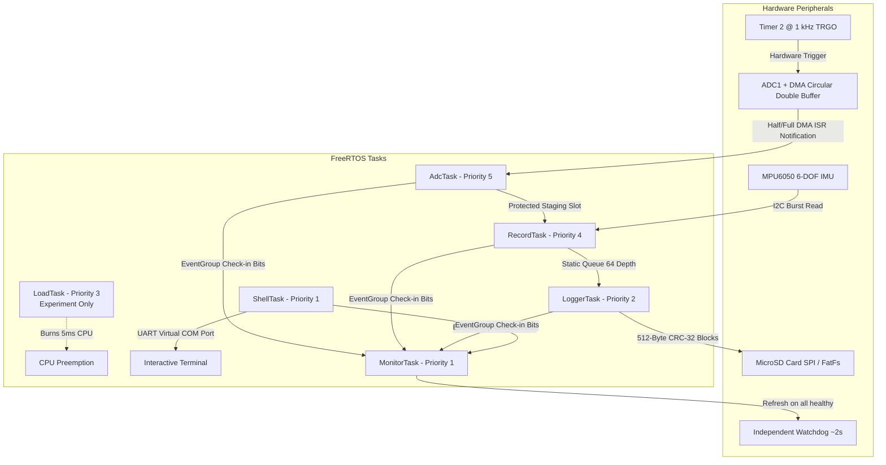

# System Architecture

## 1. Multi-Task Firmware Pipeline

---

## 2. Shared Data and Concurrency Rules

1. **AdcTask to RecordTask:**
   - Single slot `g_latest_adc` updated every 10 ms.
   - Protected by `g_staging_lock` (Mode A: Semaphore, Mode B/C: Mutex).
2. **RecordTask to LoggerTask:**
   - FreeRTOS static queue `g_record_queue` of depth 64 holding `DataRecord_t` structs (28 bytes each).
   - If queue is saturated (e.g., slow SD write), RecordTask drops newest sample and increments `s_dropped_samples`.
   - Logging is **strictly non-blocking** to high-priority sensor sampling.
3. **MonitorTask Check-in Scheme:**
   - Every active task sets its bit in `s_monitor_events`.
   - MonitorTask runs at lowest application priority (Priority 1). If any high-priority task starves the CPU, MonitorTask never runs -> watchdog resets the MCU.
